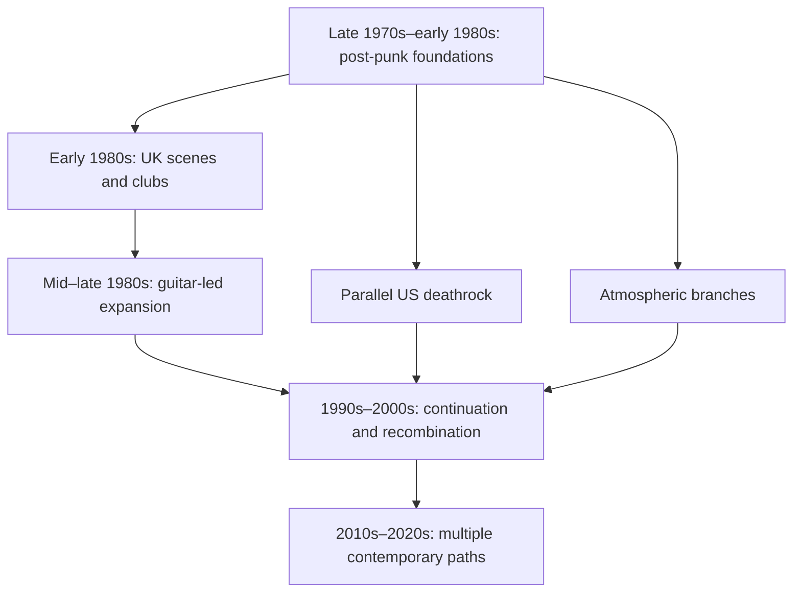

# Goth Rock — Encyclopedia History

Research checked **9 October 2026**. A connected introduction to the genre’s development, with recordings you can explore. The periods below are an editorial navigation system. They overlap; they do not establish an official three-wave taxonomy or a complete worldwide history.

## Period map

The arrows organize the account chronologically; they are not assertions that every band in one box directly influenced every band in the next.

## What developed: a sound and a community

Gothic rock grew within post-punk’s experimentation rather than appearing as a finished formula. Musicians could retain punk’s urgency while opening space for repeating bass figures, striking guitar textures, dramatic voices, and unfamiliar arrangements. In his 2023 interview, musician and historian John Robb emphasizes this experimental background and warns that several retrospectively central artists existed before the goth label became established. Their discomfort with the term does not erase their importance to later audiences. [John Robb interview, Don O’Mahony, Irish Examiner, 31 May 2023](https://www.irishexaminer.com/lifestyle/artsandculture/arid-41151901.html).

A useful encyclopedia therefore follows three related questions: what musicians changed, how listeners and venues brought recordings together, and what subsequent musicians did with those possibilities. A band can shape the scene without every album qualifying as gothic rock. Likewise, sharing a club audience does not make gothic rock, industrial music, darkwave, and gothic metal interchangeable.

## 1. Late 1970s–early 1980s: post-punk foundations

Bauhaus, Siouxsie and the Banshees, Joy Division, and The Cure offer different entrances rather than four copies of one sound. Robb treats Bauhaus’s 1979 single “Bela Lugosi’s Dead” as foundational, with its extended dramatic space. Calling it a landmark is more defensible than claiming that all gothic music suddenly began with one record. [Robb interview](https://www.irishexaminer.com/lifestyle/artsandculture/arid-41151901.html).

Joy Division’s **Unknown Pleasures (1979)** and **Closer (1980)** belong in the roots shelf. Their dates and subsequent remastered editions are distinguished in Rhino’s catalog account. The listening comparison proposed here is to follow bass, repeated rhythm, and recorded space; that is an exercise, not a claim that every later goth band took its sound directly from Joy Division. [Rhino release history](https://media.rhino.com/press-release/joy-divisions-studio-albums-and-essential-compilations).

The Banshees’ **Juju (1981)** is an especially useful guitar-and-percussion reference. The label-affiliated retrospective describes the personnel chemistry involving Siouxsie Sioux, Steven Severin, John McGeoch, and Budgie, and reports its relevance to later alternative musicians. Its original year is secure here; differing exact-day accounts should not be silently reconciled. [uDiscover retrospective](https://www.udiscovermusic.com/stories/juju-siouxsie-and-the-banshees/).

The Cure provide an unusually clear album sequence: **Seventeen Seconds (1980)** → **Faith (1981)** → **Pornography (1982)**. Read the official tracklists and Smith’s recollection of the bereavements surrounding Faith, then compare restraint, grief, and density for yourself. These are distinct records, not one generic “sad sound.” The first two newly added dossiers complement your explicitly named Pornography favorite. [Seventeen Seconds](https://www.thecure.com/release/seventeen-seconds/), [Faith](https://www.thecure.com/release/faith/), [Pornography](https://www.thecure.com/release/pornography/).

## 2. Early 1980s: a scene becomes recognizable

UK Decay connect this story to active punk networks. The band’s heritage account traces independent singles, their **For Madmen Only (1981)** debut, touring alongside punk groups, and the original band’s 1982 split. Their importance in this guide is that the emerging scene was connected to punk’s infrastructure, not sealed off from it. The heritage site’s broader influence claims are participant-side retrospective assessments. [UK Decay heritage biography](https://uk-decay.co.uk/heritage/history/breif-bio/).

London’s Batcave mattered as a place where music, performance, dress, and community met. Andi Harriman’s account of the **1982–1985** archival compilation describes a repertoire stretching across goth-associated recordings, glam, and earlier experimental music, plus performances involving Specimen and Alien Sex Fiend. A club’s varied repertoire is evidence against reducing that community to a single guitar tone. Its promotional “birthplace” language is not adopted here as an exclusive origin claim. [Batcave retrospective, 8 February 2023](https://post-punk.com/young-limbs-rise-again-the-story-of-the-batcave-nightclub-1982-1985-compilation-and-book-zeroes-in-on-goths-formative-lair-the-batcave/).

Sex Gang Children’s **Song and Legend (1983)** illustrates how theatrical arrangements could include violin and other colors beyond the standard guitar/bass/drums setup. Skeletal Family widen the northern English story: their official account documents **Burning Oil (1984)**, **Futile Combat (1985)**, BBC sessions, and touring connections with the Sisters. Those documented networks establish participation and reach without requiring an invented influence score. [Sex Gang Children album and credits](https://sexgangchildren.bandcamp.com/album/song-and-legend), [Skeletal Family biography](https://skeletalfamily.com/).

## 3. Parallel American development: deathrock

Los Angeles deathrock is a parallel strand, not simply a late import of a British “second wave.” Liz Ohanesian’s 2009 scene account places Christian Death, 45 Grave, and Kommunity FK in early local experimentation and documents later continuity around Burning Image. It is a regional account rather than a complete US history. [LA Weekly scene report](https://www.laweekly.com/the-la-deathrock-starter-guide/).

Your existing **Only Theatre of Pain (1982)**, **Sleep in Safety (1983)**, and **The Vision and the Voice (1983)** dossiers make a useful comparison set. Ask how theatrical voice, guitar attack, and rhythmic urgency differ across them. The period connection is supported; the questions are editorial. Avoid treating Christian Death’s changing personnel and later catalog as one unchanging original lineup. [Christian Death’s original-edition page](https://frontierrecords-christiandeath.bandcamp.com/album/only-theatre-of-pain-original), [Kommunity FK album page](https://kommunityfk.bandcamp.com/album/vision-and-the-voice).

This branch is especially relevant to your stated interest in raw deathrock. Follow it forward to Cinema Strange’s existing dossier and the newly added Nox Novacula record, while recognizing that comparisons do not establish direct personal influence between those bands.

## 4. Mid–late 1980s: expansion, sometimes called a second wave

For this guide, “second wave” is optional shorthand for the later expansion around the Sisters of Mercy, The Mission, and Fields of the Nephilim. It should never suggest that older bands had stopped developing or that the three groups sounded alike.

A concrete lineage exists between the Sisters and The Mission: Wayne Hussey and Craig Adams left the Sisters in late 1985 and formed a new group with Simon Hinkler and Mick Brown. **God’s Own Medicine (1986)** and **Children (1988)** let you investigate what that new group made of its own songs and larger arrangements. The official biography supplies the personnel connection; it does not prove that every later melodic goth band copied The Mission. [Mission biography](https://themissionukband.com/biography), [official albums and member recollections](https://themissionukband.com/albums).

The Sisters’ **Floodland (1987)** supplies a different expansion: Rhino describes keyboards and large orchestrations alongside the group’s programmed pulse. Its 2015 box-set page contains a wrong year for the debut; this guide retains the separately verified **1985** date for First and Last and Always. Even an official catalog source requires checking. [Floodland catalog history](https://media.rhino.com/press-release/floodland).

Fields of the Nephilim are another distinctive route. **Dawnrazor (1987)** and **Elizium (1990)** connect occult and western imagery with a guitar-led approach and extended atmosphere. Their label catalogs document both original years and later editions; claims about a vast downstream influence remain the label’s assessment unless independently established. [Dawnrazor](https://beggarsbanquetrecords.com/wp/fields-of-the-nephilim-dawnrazor-2/), [Elizium](https://beggarsbanquetrecords.com/wp/fields-of-the-nephilim-elizium/).

The Cult’s **Dreamtime (1984)** and **Love (1985)** demonstrate that musicians could move toward a broader rock vocabulary. The label describes the former’s goth connections and the latter’s change of direction. Artist membership in a historical story is therefore more useful than applying one label to an entire discography. [Dreamtime](https://beggarsbanquetrecords.com/wp/cult-the-dreamtime/), [Love reissue history](https://beggarsbanquetrecords.com/wp/the-cult-love-2023-reissue/).

## 5. Atmospheric branches developed alongside rock

Cocteau Twins’ **Garlands (1982)** and **Treasure (1984)** offer a documented early-to-later comparison, including a change from Will Heggie to Simon Raymonde in the listed personnel. Use the pairing to investigate how voice and guitar texture can become the center of an arrangement. Treasure belongs here as an atmospheric/dream-pop neighbor, rather than evidence that everything on 4AD was gothic rock. Both pages distinguish originals, bonuses, and reissues. [Garlands](https://cocteautwins.com/garlands.html), [Treasure](https://cocteautwins.com/treasure.html).

Lycia’s existing **Cold (1996)** dossier is a later atmospheric detour. Keeping this branch visible helps you decide whether you want stronger guitar attack or more enveloping space; it should not displace your current deathrock direction or become an inferred favorite.

## 6. 1990s–2000s: continuity and recombination

The next period is better understood through continuing catalogs and new collaborations than as an agreed “third wave.” Rosetta Stone’s **An Eye for the Main Chance (1991)** extends the guitar-led listening route. Sex Gang Children’s **Medea (1993)** shows an early scene band still making records. Neither becomes a new contemporary release merely because its Bandcamp edition is uploaded later. [Rosetta Stone reissue](https://rosettastoneuk.bandcamp.com/album/an-eye-for-the-main-chance-deluxe-edition), [Medea credits](https://sexgangchildren.bandcamp.com/album/medea).

Faith and the Muse provide a documented connection across American and British-associated projects: the label biography names Monica Richards and William Faith’s previous bands and records the development of **Elyria (1994)**. Their stylistic mixture broadens this guide beyond one guitar-rock model. The album’s Bandcamp date, **2001**, is explicitly a re-release, not its original year. [Metropolis biography](https://www.metropolis-records.com/artist/faith-and-the-muse), [Elyria re-release](https://faithandthemuse.bandcamp.com/album/elyria).

Cinema Strange’s existing **The Astonished Eyes of Evening (2002)** dossier provides the theatrical deathrock comparison for this period. A complete account still needs more regional documentation of independent labels, clubs, and festivals; this chapter does not substitute a handful of albums for that research.

## 7. 2010s–2020s: multiple contemporary paths

The newer discoveries do not form one universal third wave. She Past Away’s label biography documents **Belirdi Gece (2012)** and describes Turkish-language poetry within a darkwave/post-punk approach. Lebanon Hanover’s **Tomb for Two (2013)** is another, minimal coldwave-oriented route. Drab Majesty’s **The Demonstration (2017)** adds a darkwave/shoegaze comparison. These distinctions are more helpful for listening than numbering every revival identically. [She Past Away biography](https://www.metropolis-records.com/artist/she-past-away), [Tomb for Two](https://lebanonhanover.bandcamp.com/album/tomb-for-two), [The Demonstration](https://drabmajesty.bandcamp.com/album/the-demonstration).

For recent listening, compare Twin Tribes’ **Pendulum (2024)** with Nox Novacula’s **Feed the Fire (2024)**: a synth-and-guitar darkwave route beside a deathrock direction. These are useful current-generation examples, not claims that their eventual historical impact is already settled. The Cure’s **Songs of a Lost World (2024)** also shows why a history must account for established bands still releasing music. [Pendulum](https://twintribes.bandcamp.com/album/pendulum), [Feed the Fire](https://noxnovacula.bandcamp.com/album/feed-the-fire), [Cure release confirmation](https://www.thecure.com/news/2025/11/the-show-of-a-lost-world/).

Your existing 2026 Bandcamp section remains the dated discovery shelf. Connect the historical route to those releases without confusing recent release status with long-term influence.

## How this encyclopedia measures impact

The companion band guide distinguishes **foundational recording**, **documented personnel lineage**, **scene infrastructure**, **stylistic extension**, and **contemporary continuation**. These are reasons for inclusion, not numerical rankings. A similarity becomes a proven influence only when supported by participant testimony or responsible research. New artists can be valuable discoveries without being declared historical pioneers.

## Listening routes

- **Hear the foundations:** Unknown Pleasures → Juju → Seventeen Seconds → Mask.
- **Follow the later guitar expansion:** First and Last and Always → God’s Own Medicine → Dawnrazor → Elizium.
- **Follow your raw-deathrock interest:** Sleep in Safety → The Vision and the Voice → The Astonished Eyes of Evening → Feed the Fire.
- **Test atmosphere against attack:** Garlands → Treasure → Cold → The Demonstration.
- **Move into darkwave:** Belirdi Gece → Tomb for Two → Pendulum.

These are proposed sequences, not a completed listening history. The expanded record guide supplies editions and direct sources; start with three records rather than trying to absorb the whole catalog at once.

## Research still to extend

This edition covers selected UK, US, and contemporary international connections. France’s coldwave histories, Germany’s independent networks, Latin American scenes including Chile, and Asian scenes need their own adequately sourced chapters. Dead Can Dance, The Birthday Party, Virgin Prunes, The March Violets, Play Dead, Xmal Deutschland, Clan of Xymox, and more remain important candidates for the next expansion, rather than silently omitted from an asserted complete canon.