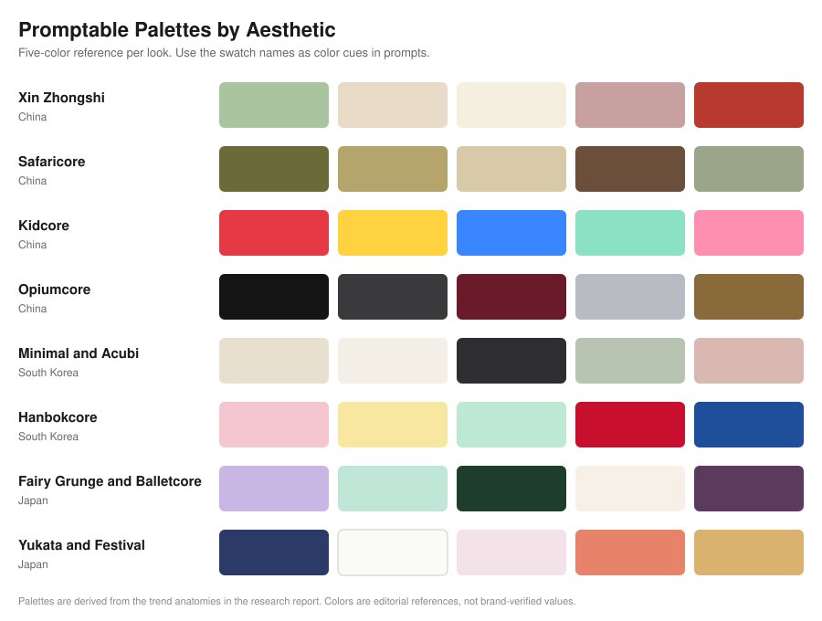
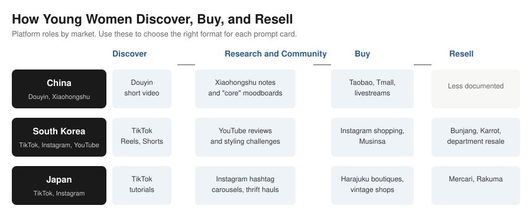
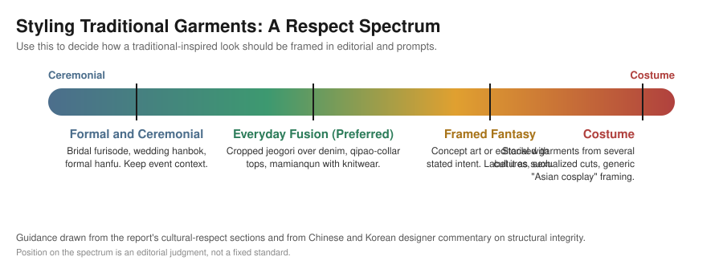
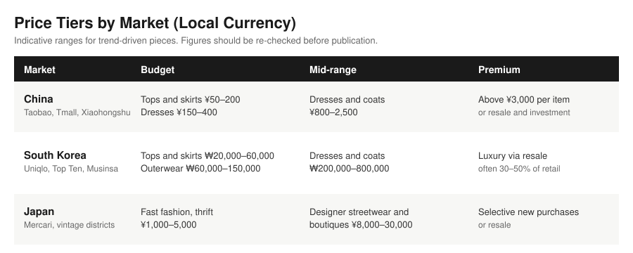

# Fashion Trends 2025–2026: Young Women in China, Japan, and South Korea

**Promptable Aesthetics for a Generative Fashion Magazine**

*Research report, v2 · October 2026 · Target audience: women aged 18–28*

---

## Scope and Method

This report covers fashion among young women aged 18 to 28 in China, Japan, and South Korea, with a focus on 2025 and 2026. It is written for editorial and prompt-design work: each aesthetic is broken down into visual building blocks that can be turned into text-to-image prompts.

Version 2 adds sources and checks the figures in version 1 against the original reports. Numbered citations in square brackets, such as [3], refer to the Sources list at the end. Where a figure could not be confirmed, or comes from a single platform claim, an aggregator, or a partially redacted dataset, it is marked **[Verify]**. Where sources disagree, both views are shown.

---

## Corrections to Version 1

Checking the earlier draft against primary and secondary sources turned up several figures that needed correcting.

| Claim in v1 | Status in v2 | What the sources say |
|---|---|---|
| Mamianqun orders up "over 800%" on Douyin | **Corrected** | Horse-faced skirt orders among female Douyin users rose 841% year on year, per the Douyin E-commerce 2024 female consumer report, as reported by China Daily [7]. |
| Hanfu group bookings up "over 600%" at May Day 2025 | **Unconfirmed** | Not found in the sources reviewed. Remove or verify before use. |
| About 70% of Xiaohongshu users are female | **Refined** | Reporting cited on Wikipedia says about 90% of users were women in 2021, and about 30% were men by 2022 [5]. Current figures are not confirmed. |
| 71% of Japanese Gen Z have bought secondhand | **Replaced** | A BCG-conducted survey found 52% of Gen Z and 47% of Millennials bought secondhand or refurbished goods in the previous 12 months [21]. |
| Korean resale market reached 43 trillion won in 2025 | **Clarified as a projection** | Canvas8 reported a projected ₩43 trillion for 2025, up from ₩4 trillion in 2008 [12]. SeoulZ attributes a similar figure to KISA [13]. |

---

## Executive Summary

Young women in the three markets are navigating a mix of cultural revival, global streetwear, and digitally native micro-aesthetics. The trend cycle now moves quickly, and many young consumers say they are less interested in chasing it.

Five cross-market themes stand out:

1. **Cultural fusion.** Hanfu, hanbok, and kimono or yukata references are moving into everyday and streetwear contexts [8][9][18].
2. **Expressive and emotionally driven dressing.** After years of quiet luxury, Chinese Gen Z is embracing expressive dressing, and at the same time many are opting out of trend-chasing altogether [2][6].
3. **Y2K and sport-core revivals.** Nostalgic silhouettes and sportswear such as jerseys and tennis skirts recur across the three markets [1][3].
4. **Gender-fluid silhouettes.** Oversized, menswear-inspired, and genderless fits have become standard in Seoul and Tokyo street style [16][17][33].
5. **Affordability through resale and dupes.** Secondhand buying has moved into the mainstream, especially in Japan and Korea [12][21][14].

The aesthetics most useful for reusable prompts are New Chinese Style, the Chinese subculture cores, minimal and Acubi streetwear, hanbokcore, Harajuku hybrids, and seasonal yukata imagery. Each one has recognizable silhouettes, palettes, accessories, and settings (see Figure 1).

---

## Cross-Market Overview

### Shared building blocks

Gen Z women in the three markets consume global content and mix influences freely. The shared vocabulary includes:

- **Silhouettes:** oversized blazers and trench coats, wide-leg pants, pleated mini skirts, tulle skirts, technical sneakers, simple tees
- **Palettes:** soft neutrals and pastels, with bold primaries kept for accents or subcultures
- **Accessories:** chunky sneakers, mini crossbody bags, plush charms, hair bows, ties, simple jewelry

### Platform roles

Short-form video drives discovery in all three markets. Commerce and community then happen on different platforms in each country (see Figure 4).

### Market signals worth tracking

- **Trend fatigue.** Commentary on Chinese Gen Z describes a shift away from chasing trend cycles toward self-directed dressing and "emotional value" (情绪价值) in purchases [2][6].
- **Speed of production.** Reporting on Xiaohongshu links the platform to fast-fashion consumption, with users copying looks they see and buying quickly [4].
- **Resale as a default.** Japan and Korea both show large shares of younger consumers buying secondhand, which is changing how brands think about entry points [12][21].

---

## China

### 1. New Chinese Style (Xin Zhongshi) and Hanfu Revival

**Trend overview.** Hanfu has moved well beyond photoshoots. Horse-faced skirts (mamianqun) are the clearest example. Douyin's 2024 female consumer report recorded an 841% year-on-year rise in horse-faced skirt orders among female users [7]. Alibaba's platforms recorded hanfu sales by product type in January 2024, with mamianqun described as the main hanfu skirt product [10]. A 2024 People's Daily report noted that one store's monthly mamianqun sales had topped 3 million yuan [9]. Local manufacturing is growing too. Caoxian County in Shandong is described as the country's largest hanfu production base [9], and a town-level report cited by state media says eight in ten students surveyed like hanfu. That figure is unverified and listed for checking [11].

**Everyday use.** Academic work on modern hanfu covers both role-play and everyday wear [38]. Designers in press coverage argue that minimal structural changes and better fabric and craftsmanship are the best route to everyday integration [8].

**Visual building blocks**

- **Silhouettes:** high-waisted mamianqun with structured front panels and subtle pleats, ankle or mid-calf length; qipao-inspired sheath dresses with stand collars and side slits in looser cuts; boxy cropped jackets with hanfu or Tang-style collars over slim tops
- **Garment types:** hanfu dresses (inner robes and outer coats), mamianqun, qipao-style dresses, hoodies with hanfu collars, wide-leg pants with embroidered hems, trench coats with knot buttons
- **Fabrics and textures:** light silk blends and chiffon for skirts; cotton jersey and technical nylon for qipao-style tops; matte crepe and textured linen; occasional glossy satin for festive looks
- **Palette:** pale jade, soft beige, cream, dusty rose, muted lake blue, with cinnabar red and gold embroidery; Guochao looks may add crimson, imperial yellow, or black with dragon and cloud motifs
- **Accessories:** jade pendants, pearl earrings, embroidered silk handbags, delicate hairpins; ornate headpieces and folding fans for photoshoots
- **Hair and makeup:** soft waves or straight mid-length hair; natural base, slight blush, red or brick lips; historically inspired updos and more defined eyeliner for hanfu looks
- **Settings:** historic districts (Suzhou, Hangzhou, the Xi'an city walls), old streets and teahouses, palace courtyards; soft daylight or golden hour; slightly filtered, pastel-toned color grading common on Douyin and Xiaohongshu

**Sample prompt:**
> Young Chinese woman in Xin Zhongshi style: high-waisted mamianqun skirt, cotton qipao-collar blouse, jade pendant, soft neutral palette, walking through a Suzhou old street at golden hour, cinematic street photography.

### 2. Subculture Cores and Expressive Dressing

Xiaohongshu has become a moodboard in which Chinese Gen Z sort their style into named "cores." Jing Daily's 2025 analysis describes safaricore, kidcore, goblincore, and dirtycore, among others [1]. Its 2026 outlook adds that Gen Z has moved from quiet luxury to more emotionally charged dressing, with plush charms hung from luxury bags as a visible example [2].

Sport-led looks are also rising. Reporting on Xiaohongshu's sportswear surge describes blokecore and jersey chic moving from fitness wear into everyday fashion [1]. The specific search-growth figure circulating for blokecore (over 30×) could not be confirmed and is marked **[Verify]**.

At the darker end, opiumcore streetwear draws on gothic and punk references. Its reported view counts on Xiaohongshu are not confirmed **[Verify]**.

**Core profiles**

- **Safaricore:** utility vests, cargo shorts, hiking jackets, bucket hats; khaki, olive, beige, earthy browns; café districts or outdoor settings with film-style grain
- **Kidcore:** colorful graphic tees, cartoon knits, playful hair accessories; bright primaries, neons, and multicolor mixes; blush and eye glitter
- **Goblincore and dirtycore:** distressed denim, layered mismatched knits, patched jackets; earthy and muted tones; urban alleys or outdoor backdrops. Jing Daily links goblincore to forest greens and "mystical femininity," which also suits fantasy-leaning prompts [1]
- **Opiumcore:** leather jackets and pants, strap-heavy tops, corset details, chains; black, charcoal, deep burgundy, metallic silver; gradient lips and dramatic eyeliner; moody low-light streets
- **Blokecore and jersey chic:** football jerseys, varsity jackets, retro track pants, tennis skirts; chunky sneakers and sports caps; football pitches, courts, or city streets

**Sample prompt:**
> Chinese Gen Z safaricore outfit: khaki cargo skirt, hiking jacket, bucket hat, neutral tones, shot in a Chengdu café district with film-style grain.

### 3. Brands Shaping the Look

Jing Daily's brand list for 2026 uses Xiaohongshu hashtag impressions as a rough signal of reach. The figures are platform-reported and hashtag-level, so treat them as directional [3].

| Brand | Positioning | Xiaohongshu hashtag impressions (reported) |
|---|---|---|
| Shushu/Tong | Coquette-core, ultra-feminine details, relaxed tailoring | 199.8 million |
| Pet Tree Kor | Not described in detail in the source | 14.1 million |
| Ming Ma | 3D cutting combined with modern femininity | 13.6 million |
| Nφdress | Seoul-based label reimagining 1990s Chinese and Japanese street fashion | 10.2 million |

Other labels gaining traction with Chinese Gen Z include Sunset Park, Dotyears, Scry, Bhive, and Hudiegongzhu [3]. Nφdress is a useful bridge between China and Korea for a cross-market editorial.

### 4. Cultural Respect: Hanfu in Contemporary China

Reporting on hanfu consistently describes it as everyday clothing and an expression of cultural identity, not cosplay [7][26][27]. Young women rent and buy hanfu for scenic photos and for regular wear [26].

Respectful reinterpretation keeps the structure and historical symbolism of garments intact and integrates collars, skirts, and motifs into practical clothes. Designers in the coverage caution against altering ceremonial hanfu purely for trend appeal [8].

**Editorial guidance**

- Treat hanfu-inspired outfits as everyday fashion or cultural expression, not fantasy cosplay, unless the story explicitly frames them as historical role-play.
- Use accurate garment names (mamianqun, beizi, qipao, hanfu robe) and pair full traditional looks with appropriate settings.
- Avoid combining hanfu with props that are sexualized or disrespectful, such as weapons or fetish gear, unless the context is clearly critical.

### 5. Audience and Platforms

Xiaohongshu is a primary research platform for urban women researching fashion, beauty, and travel. Its user base has been majority female, with about 90% women reported in a 2021 report and about 30% male by 2022 [5]. Users look for authentic reviews and styling diaries, and they treat saves and shares as signals of value.

Douyin combines entertainment and commerce, with fashion shown through short video and livestreams [4]. Livestream hosts mix pieces in real time and answer questions, which can drive impulse buying [4].

**Formats that work**

- Short-video OOTDs and get-ready-with-me (GRWM) content, styling tutorials, and outdoor "small escape" looks
- Multi-photo Xiaohongshu notes with a breakdown of brands, prices, and styling logic
- Livestream styling sessions with real-time Q&A

### 6. Price Tiers, Quality-to-Price Thinking, and Dupes

Chinese Gen Z often weighs quality against price rather than chasing brand status, which is a theme in Jing Daily's coverage [2]. One audience analysis suggests many university-age buyers spend roughly ¥50–300 on fashion items and ¥20–150 on accessories **[Verify]**.

- **Budget:** fast fashion, Taobao and Tmall brands, domestic streetwear labels; tops and skirts about ¥50–200, dresses about ¥150–400
- **Mid-range:** domestic designer brands and imported mid-range labels; dresses and coats often ¥800–2,500
- **Premium:** international luxury and high-end domestic labels, typically above ¥3,000 per item, increasingly accessed through resale or as investment pieces

In China, dupes are often "inspired" items rather than counterfeits. Domestic labels and Guochao offer culturally resonant alternatives to imported brands.

### 7. Body Diversity and Representation

Xiaohongshu has seen body-positivity content grow, including hashtags that push back against "appearance anxiety" [32]. Terms such as *weipang* and mid-size influencers reflect growing acceptance of bodies beyond ultra-thin ideals. Mainstream fashion imagery still leans slim, while Gen Z discourse prizes authenticity and comfort, especially in Guochao and casual looks that use oversized menswear [32].

**Editorial guidance**

- Use varied body descriptors (petite, midsize, tall, curvy) and favor comfort-oriented silhouettes such as loose shirts, wide-leg pants, and relaxed skirts.
- Do not imply that hanfu or Xin Zhongshi styles suit only slim bodies.

---

## South Korea

### 1. Minimal Streetwear, Acubi, and Y2K

Korean women's streetwear in 2024–2025 blends oversized layering, soft neutral palettes, and technical details with Y2K nostalgia and K-drama and K-pop influence [16]. The Acubi aesthetic, with bolero tops, wide-leg denim, asymmetric silhouettes, and gender-neutral fits, peaked around 2025 [16].

Seoul street style has also been mapped into named codes. Fuga Studios groups Seoul looks under a shared layering rule, "three layers visible, one hidden" [16]. Commentary on Seoul's 2026 output sorts it into five codes, including K-Minimal, K-Soft, K-Pop Stage, K-Genderless, and K-Streetwear [16]. Seoul Fashion Week FW26 street-style coverage notes attendees' ability to anticipate trends [17]. The codes work well as prompt categories, and they often overlap on the street.

**Visual building blocks**

- **Silhouettes:** oversized top with wide-leg bottom; cropped bolero over high-waisted jeans; long trench or leather coat over simple layers
- **Garment types:** trench coats, blazers, oversized hoodies, bolero shrugs, pleated skirts, wide-leg jeans, midi skirts, cargo pants, nylon jackets, utility vests
- **Fabrics and textures:** heavy cotton fleece, mid-weight knits, structured denim, smooth nylon, occasional leather; matte and slightly glossy surfaces layered together
- **Palette:** monochrome outfits (all beige, all charcoal), soft neutrals with muted pastels, plus one pop accent such as a bright bag or cap
- **Accessories:** caps, canvas crossbody bags, totes, chunky sneakers, minimal jewelry; varsity jackets and statement graphic tees
- **Hair and makeup:** natural base, straight or softly waved hair, gradient lips, defined brows; K-pop-inspired looks may add glitter or stronger eyeliner
- **Settings:** Hongdae, Seongsu-dong, café streets, university campuses; daylight with clean color grading

**Sample prompt:**
> Korean Acubi streetwear look: oversized beige trench, bolero knit over a white tee, wide-leg denim, chunky sneakers, neutral Seoul café street background, daylight street photography.

### 2. Hanbokcore and Casual Hanbok Fusion

Hanbok is being reinterpreted for everyday wear. Designers and younger consumers are driving the shift, as reported in Korea Times and Korea Herald coverage [18][19][20]. A Korea Times interview with designer Kwon Hye-jin describes hanbok-inspired designs that pair traditional structure with contemporary shapes [19]. Coverage linked to a Netflix-driven boom describes hanbok trending again among younger viewers [18].

"Hanbokcore" styling pairs cropped jeogori with denim, hanbok-inspired skirts with sneakers, and norigae-style tassels layered with modern outfits [18][19].

**Visual building blocks**

- **Silhouettes:** cropped jeogori over high-waisted jeans or a chima-inspired skirt; layered or lifted-panel chima for ceremonial-style photo looks
- **Garment types:** modern hanbok vests, shortened chima skirts, hanbok-inspired jumpsuits, casual jeogori in cotton or linen, paired with denim, leather pants, or contemporary shirts
- **Fabrics and textures:** lightweight silk blends, cotton, and linen for everyday hanbok; richer layered fabrics for ceremonial wear
- **Palette:** pastel and traditional vivid colors (soft pink, pale yellow, mint, bright red, blue), often in two-tone combinations
- **Accessories:** norigae tassels as belt ornaments, small folding fans, gat-inspired earrings, modern sneakers
- **Hair and makeup:** loose hair or low buns with subtle nods to tradition; light base and soft lip colors
- **Settings:** Gyeongbokgung and other palaces, Bukchon Hanok Village, contemporary cityscapes; editorial shoots can contrast traditional garments with modern architecture

### 3. Cultural Respect: Hanbok Use

Hanbok is still mostly reserved for weddings, first birthdays, major holidays, and staged photoshoots, while casual fusion is emerging as everyday wear [18][20]. Designers and cultural institutions encourage experimentation with silhouettes and fabrics while keeping core structure and color symbolism [19].

**Editorial guidance**

- Distinguish **ceremonial hanbok** (formal, event-focused) from **casual hanbok fusion** (shorter jackets, simplified skirts, practical fabrics).
- Avoid using hanbok purely as an exotic prop, especially in non-Korean contexts without explanation.
- For non-Korean wearers, present hanbok as respectful appreciation, such as palace rental experiences, rather than costume.

### 4. Audience and Platforms

K-fashion's global reach depends on social media, especially YouTube, Instagram, and TikTok, with influencer collaborations as a core strategy [16]. Korean Gen Z women rely heavily on social platforms for fashion information and purchase decisions [16].

**Formats that work**

- Outfit breakdown reels showing quick styling tips and "basic to K-drama inspired" transformations
- Challenge-based content that pairs K-pop music with outfit reveals
- Long-form YouTube reviews of products and collections, which support higher-value purchases

### 5. Price Tiers, Resale, and Dupes

Korean resale is large and growing. Canvas8 projected the secondhand luxury market to reach ₩43 trillion in 2025, up from ₩4 trillion in 2008, with Gen MZ shoppers leading the shift [12]. SeoulZ, citing KISA, gives a similar figure but notes it excludes the wider secondhand market [13]. Both figures are projections and should be labeled that way **[Verify]**.

Adoption is broad. A survey cited by SeoulZ reports that 65% of MZ-generation consumers have bought a secondhand item at least once [13]. Department stores have opened pre-owned luxury spaces for this group, including Lotte, Shinsegae, and Hyundai [12].

Dupe culture has spread too. Reporting describes young Koreans favoring smart spending over brand status and replacing luxury queues with searches for alternatives [14]. The Korea Times has covered the dupe trend and the growing sophistication of counterfeits, which is a regulatory concern [15]. Editorial guidance should present legal dupes as creative value and avoid promoting counterfeits.

- **Budget:** fast fashion and local streetwear (Uniqlo, Top Ten, Musinsa house brands); tops and skirts often 20,000–60,000 won; outerwear 60,000–150,000 won
- **Mid-range:** Korean designer labels and imported mid-tier brands; dresses and coats around 200,000–800,000 won
- **Premium:** international luxury, increasingly accessed through resale; secondhand prices may be 30–50% of original retail

### 6. Body and Gender Expression

Genderless and unisex silhouettes are a dominant strand of Korean streetwear, with menswear-inspired pieces for women prominent in coverage [16][33]. Oversized, comfortable fits match broader Gen Z preferences for comfort over strict gender coding [33].

Mainstream K-pop and K-drama imagery still often foregrounds slender bodies, which limits inclusivity in practice. Secondhand and dupe culture may widen the range of bodies represented by reframing pre-owned pieces as vintage and mix-and-match options [12].

**Editorial guidance**

- Use gender-neutral silhouettes (boxy shirts, slacks, long coats) and show styling for all genders.
- Show a range of body types in oversized streetwear and hanbokcore outfits.

---

## Japan

### 1. Harajuku Hybrids and Micro-Trends

Japanese women's fashion is diverse and centered on Harajuku and nearby districts, which act as testing grounds for hybrid styles that mix kawaii, punk, minimalism, and sustainability [34].

- **MEN'SLIKE:** androgynous, oversized silhouettes, barrel-cut denim, menswear-inspired blazers and shirts styled by women
- **Fairy grunge:** fairycore motifs such as butterflies and lace, combined with grunge elements like chunky boots and dark layers
- **Sweet lolita and neo Mori girl:** voluminous skirts, lace blouses, and pastel palettes for sweet lolita; forest-inspired layered dresses and knits for Mori girl
- **Balletcore:** lace tops, tulle skirts, leg warmers, and ballet flats, often mixed with sporty outerwear [34]
- **Modern gyaru:** short skirts, fitted blazers, and gold accessories, updated from 1990s and 2000s gyaru [34]

**Visual building blocks**

- **Silhouettes:** layered dresses under oversized outerwear; pleated shorts or skirts over tights; barrel-leg jeans; men's blazers over delicate tops
- **Garment types:** lace tops, tulle skirts, corset-style bodices, graphic tees, oversized shirts and blazers, knit boleros, technical sneakers
- **Fabrics and textures:** lace, tulle, cotton jersey, denim, knitwear; occasionally vinyl or faux leather for cyberpunk influence
- **Palette:** pastel pink, lavender, mint, and cream for sweet and balletcore; dark greens, blacks, and muted florals for fairy grunge; neutral menswear tones for MEN'SLIKE
- **Accessories:** plush charms on bags, knee-high socks (sheer or patterned), ties worn over airy shirts, mini crossbody bags, chunky boots or Mary Janes
- **Hair and makeup:** natural to fully styled; soft blush and eye-focused makeup; the two-layer Hime cut is resurging
- **Settings:** Harajuku alleys, Shimokitazawa vintage shops, Tokyo train stations, thrift store interiors; candid, documentary-style framing

**Sample prompt:**
> Tokyo fairy grunge look: layered lace dress under a black oversized blazer, knee-high sheer socks, chunky boots, pastel plush charm on a bag, Harajuku street background, overcast daylight.

### 2. Yukata and Seasonal Imagery

Kimono and yukata are mostly reserved for formal or seasonal occasions, but they shape contemporary aesthetics and photo settings. Yukata is casual, festival-oriented wear, popular for fireworks, bon-odori dances, and onsen or ryokan stays [35].

**Visual building blocks**

- **Silhouettes:** straight robe with obi belt; ankle-length with short sleeves; paired with geta sandals
- **Fabrics:** lightweight unlined cotton or cotton blends; bold prints such as florals, geometrics, and modern graphics
- **Palette:** indigo and white classics; modern versions in bright florals, pastel backgrounds, or pop-culture motifs
- **Accessories:** obi, small handbags, hairpins, wooden sandals; occasionally straw hats
- **Settings:** summer festivals, fireworks, onsen towns, shrine paths; warm evening lighting with lanterns

### 3. Cultural Respect: Kimono and Yukata

Kimono types follow a clear formality hierarchy. Furisode, with long sleeves, is associated with unmarried young women and formal occasions. Komon is a casual outing garment, and yukata is strictly casual and festival-oriented [35]. Everyday fashion in Japan is largely Western, with kimono kept for special outings [35].

**Editorial guidance**

- Use accurate names (furisode, komon, yukata) and match each to an appropriate setting.
- Avoid placing bridal or ceremonial kimono in casual street scenes without explanation.
- Frame non-Japanese wearers as taking part in real practices, such as rental kimono at temples, rather than costume play.

### 4. Audience and Platforms

Japanese women in their twenties use Instagram for fashion and beauty research and TikTok for trend discovery [34]. TikTok's reach among Gen Z is strong, and its audience responds to creative, humorous, and trend-driven videos, though educational styling tutorials also perform well. Japanese audiences often value privacy and curated, consistent feeds, so detailed captions and hashtags matter.

**Formats that work**

- Hashtag-driven outfit carousels with location- and style-specific tags
- Short TikTok styling tutorials covering Harajuku micro-styles, thrift hauls, and mixing imported K-fashion or Nordic aesthetics

### 5. Price Tiers, Secondhand, and Dupes

Japan's secondhand market is mature. A Mercari survey found that more than half of Gen Z respondents believe their possessions can easily be converted into cash, and younger respondents discard fashion items far less often than older ones [22].

The clearest recent figures come from a BCG-conducted survey of consumers aged 15 to 69: 52% of Gen Z and 47% of Millennials bought secondhand or refurbished goods in the previous 12 months. About 30% of Gen Z say they consider secondhand options from the start of their shopping. Luxury fashion is among the categories with high demand [21]. Statista's 2025 survey of Japanese consumers provides category-level breakdowns of secondhand purchases [23]. The leading stated reason for interest in secondhand luxury is access to lower price points [24]. Vintage districts such as Shimokitazawa are a common setting for thrift buying, though this is not yet supported by a source in this list.

- **Budget:** fast fashion, domestic brands, thrift and vintage finds; typically 1,000–5,000 yen
- **Mid-range:** designer streetwear and Harajuku boutique brands; typically 8,000–30,000 yen
- **Premium:** international labels and high-end Japanese brands, usually accessed through selective new purchases or resale

### 6. Body and Gender Expression

Research on unisex fashion suggests Gen Z values comfort and fit above brand or trend [34]. Social platforms have driven genderless narratives in Japan as elsewhere. Mainstream Japanese fashion media, however, often depicts thin bodies, and privacy norms can limit some forms of self-expression.

Harajuku, independent designers, and secondhand culture offer more experimental and inclusive options through individualized silhouettes and layering. Prompts can lean on MEN'SLIKE, oversized streetwear, and layered Mori or fairy styles to support diverse bodies.

---

## Cross-Market Mixing

### Mixing that works

Combinations that read as creative rather than careless include:

- Korean minimalist knitwear layered with Japanese MEN'SLIKE barrel-leg denim and a plush bag charm
- A Chinese Xin Zhongshi qipao-collar blouse with Korean wide-leg trousers and Japanese knee-high socks
- A hanbok-inspired jacket over straight-leg denim with modern sneakers
- Blokecore jerseys with pleated tennis skirts and gender-neutral outerwear

Mixing is praised when it keeps the integrity of each reference, adds modern pieces, and uses culturally informed color and motifs rather than surface-level exoticism.

### Combinations seen as careless or costume-like

- **Stacking traditional garments** from different cultures in one casual outfit, such as hanbok jeogori, hanfu skirt, and kimono obi, without narrative or context
- **Hyper-sexualized traditional garments**, such as revealing hanbok or hanfu cuts marketed as "Asian cosplay." Designers advocating respectful modernization have criticized this [8][19]
- **Ceremonial garments in everyday street scenes**, such as bridal furisode or wedding hanbok silhouettes, which can feel inauthentic unless clearly framed as fantasy or concept art [35]

---

## Audience Needs and Content Formats

### What young women want

- **Inspiration and identity:** micro-aesthetics and cultural fusion, with emphasis on individuality and belonging [1][2]
- **Affordability guidance:** price breakdowns, secondhand and dupe recommendations, and styling with accessible brands [12][21]
- **Styling tutorials:** layering advice and outfit transformations adapted to body types and lifestyles
- **Community and user content:** user-submitted looks and community-driven features

### Best-performing formats

- **Short-form video** (Douyin, TikTok, Reels) is the default for discovery in all three markets
- **Carousels and lookbooks** on Instagram and Xiaohongshu suit visual detail and save-worthy guides
- **Long-form reviews** on YouTube support purchases of higher-priced items [16]
- **Livestreams** drive impulse shopping and allow real-time styling questions [4]

For a generative magazine, pair written breakdowns with platform-native prompt cards (short video, carousel, livestream) and community submission features.

---

## Forecast: Trends to Watch (12–18 Months)

1. **Hanfu, hanbok, and New Chinese and Korean traditional fusion.** Cultural confidence, state promotion, and rising e-commerce activity point to more everyday integration [7][9][18]. *Content angle:* "Tradition in Daily Outfits," a series of respectful prompts pairing hanfu-inspired skirts and hanbok jackets with modern basics.

2. **Sport-style, blokecore, and jersey chic.** Sportswear momentum on Xiaohongshu and sport-mix styling in Japan and Korea suggest sustained demand [1][3]. *Content angle:* "Match-Day Looks Across Asia," combining jerseys, pleated skirts, sneakers, and gender-neutral layering.

3. **Genderless and oversized minimalism.** Comfort-first, authenticity-driven style suggests unisex silhouettes will keep normalizing [16][33]. *Content angle:* prompt templates with interchangeable gender and body descriptors.

4. **Body-positive and midsize representation.** Xiaohongshu's body-positivity content and inclusive runway events point toward more varied casting and styling [32]. *Content angle:* "Midsize Outfit Labs," focused on fit and layering, with prompts specifying varied body shapes.

5. **Secondhand and dupe-smart styling.** Japanese and Korean resale data show mainstream adoption [12][21]. Framing is shifting from environmental to financial, as in "smart spending" [13][21]. *Content angle:* "Thrift Remix Challenges," "Dupe vs. Original" styling, and "Vintage Highlight Pieces."

6. **Micro-subcultures** (fairy grunge, opiumcore, goblincore, balletcore). Xiaohongshu and Harajuku will keep producing niche aesthetics that travel quickly [1][34]. *Content angle:* modular prompt libraries for each core.

7. **Grounded, self-directed dressing.** Commentary on Chinese Gen Z points to a shift from chasing trend cycles toward dressing for personal meaning and comfort [2][6]. *Content angle:* "Own Your Look" features built on personal palettes and repeatable wardrobe formulas rather than the newest micro-trend.

---

## Prompt Design Guidelines

- **Anchor every prompt in a regional context.** Specify the city or district and the aesthetic, then describe silhouette, fabrics, palette, accessories, and setting.
- **Encode cultural context for traditional garments.** State the occasion (festival, palace visit, wedding, daily fusion wear), and avoid combining several traditional garments without narrative justification. Use Figure 2 to position each look.
- **Include price-tier and accessibility cues.** Hints such as "budget-friendly streetwear," "mid-range designer coat," or "vintage bag find" reflect real purchasing patterns.
- **Specify body and gender descriptors.** Note body type, height range, and gender expression where relevant.
- **Specify format variants.** For each look, provide versions for short video (dynamic poses), carousels (multiple angles), and static covers (hero shot with a clear silhouette).

**Reusable prompt template**

> [Market and city/district] [aesthetic name] look: [garment 1], [garment 2], [fabric or texture], [palette], [accessories], [hair and makeup], [setting], [lighting and framing], [body and gender descriptor], [price-tier cue].

**Editorial notes**

- Describe models as **adults** and keep styling content age-appropriate. Image generators and platforms apply stricter rules to content involving people who may be minors.
- Describe styles rather than naming specific idols, influencers, or other real people. This also avoids right-of-publicity concerns.
- Test prompts across several image tools before publishing, because outputs vary significantly between models.

**On visuals.** The figures in this report are diagrams and palette references, not photographs. For photographic model images, use licensed stock, commissioned photography, or AI-generated images with clear usage rights. Do not embed photos scraped from social platforms or fashion publications.

---

## Remaining Verification Priorities

These claims still need checking against primary sources before publication:

- The May Day 2025 hanfu booking growth figure (China)
- Blokecore search growth and opiumcore view counts (China)
- Individual spending ranges for Chinese university-age buyers (China)
- Dupe-purchasing comparisons by country from the 2025 Statista survey, which is partially redacted (cross-market)
- Korean resale market size and whether figures are projections or actuals (South Korea)
- Japanese Gen Z purchase-category rankings (Japan)
- The Daiji survey figure that eight of ten students like hanfu (China)

---

## Sources

**China**

[1] Jing Daily, "Goblincore, Gabargecore: 2025 in Xiaohongshu fashion." https://jingdaily.com/posts/china-s-gen-z-core-trends-of-2025
[2] Jing Daily, "How China's Gen Z will dress in 2026." https://jingdaily.com/posts/what-china-s-gen-z-will-wear-in-2026
[3] Jing Daily, "Which brands are Chinese Gen Z wearing in 2026?" https://jingdaily.com/posts/which-brands-are-chinese-gen-z-wearing-in-2026
[4] Jing Daily, "Is Xiaohongshu fueling Gen Z's fast fashion obsession?" https://jingdaily.com/posts/gen-z-xiaohongshu-fast-fashion
[5] Wikipedia, "Xiaohongshu." https://en.wikipedia.org/wiki/Xiaohongshu
[6] RADII, "Why China's Gen Z stopped following trends and started following themselves." https://radii.co/article/why-chinas-gen-z-stopped-following-trends-and-started-following-themselves
[7] China Daily via Asianews Network, "Rediscovering Chinese aesthetics." https://asianews.network/?p=139732
[8] China Daily Hong Kong, hanfu feature on structural integrity and everyday integration. https://chinadailyhk.com/hk/article/381940
[9] People's Daily Online, "New Chinese-style fashion fuels consumption growth" (February 2024). https://www.chinakongzi.org/English/CulturalHighlights/202402/t20240228_571430.htm
[10] Statista, Hanfu sales volume on Alibaba platforms by type (January 2024). https://www.statista.com/statistics/1473216/china-hanfu-sales-volume-on-alibaba-platforms-by-type
[11] Asianews Network, "Traditional culture drives rural vitalization." https://asianews.network/?p=110641
[26] Channel NewsAsia, on the growth of hanfu experiences. https://www.channelnewsasia.com/east-asia/china-hanfu-experience-cultural-confidence-new-face-popularity-5653586
[27] Global Times, "Hanfu craze: Gen Z revives traditional clothing" (November 2024). https://www.globaltimes.cn/page/202411/1322989.shtml
[32] Focus, CBBC, "Exploring China's body positivity movement." https://focus.cbbc.org/exploring-chinas-body-positivity-movement/
[38] Fashion Practice, "Modern Hanfu and Role-Play." https://www.tandfonline.com/doi/abs/10.1080/17569370.2025.2585874

**South Korea**

[12] Canvas8 via Marketech APAC, South Korean second-hand luxury market. https://marketech-apac.com/younger-south-koreans-drive-second-hand-luxury-surge-prioritising-sustainability-and-savings
[13] SeoulZ, "Korea recommerce market 2026." https://www.seoulz.com/korea-recommerce-market-2026/
[14] Inside Retail, "Young South Koreans forsake luxury brands for dupe products" (February 2025). https://insideretail.asia/2025/02/10/young-south-koreans-forsake-luxury-brands-for-dupe-products/
[15] Korea Times, "'Dupe trend' takes hold in Korea as counterfeits evolve" (February 2025). https://www.koreatimes.co.kr/amp/lifestyle/trends/20250214/dupe-trend-takes-hold-in-korea-as-counterfeits-evolve
[16] Fuga Studios, "Modern Korean Fashion." https://fuga-studios.com/en/blogs/journal/modern-korean-fashion
[17] NSS Magazine, Seoul Fashion Week FW26 street style (February 2026). https://www.nssmag.com/de/fashion/44219/die-besten-streetstyle-looks-von-der-seoul-fashion-week-fw-2026
[18] Korea Times, "From ritual wear to runway: Korea's traditional hanbok is trending again" (October 2025). https://www.koreatimes.co.kr/lifestyle/trends/20251005/from-ritual-wear-to-runway-koreas-traditional-hanbok-is-trending-again-thanks-to-netflix
[19] Korea Times, interview with designer Kwon Hye-jin of Studio Hyeon (March 2025). https://www.koreatimes.co.kr/lifestyle/20250313/designer-kwon-hye-jin-of-studio-hyeon-shares-vision-for-tomorrows-hanbok
[20] Korea Herald, "Hanbok gets dressier for modern celebrations." https://www.koreaherald.com/article/10758014
[33] Fashionating World, "From Seoul to São Paulo: How Gen Z is driving a genderless fashion future." https://www.fashionatingworld.com/new1-2/from-seoul-to-sao-paulo-how-gen-z-is-driving-a-genderless-fashion-future

**Japan**

[21] Zenbird, summarizing a Boston Consulting Group survey on secondhand purchasing in Japan. https://zenbird.media/survey-reveals-japans-gen-z-and-millennials-are-embracing-second-hands/
[22] Zenbird, summarizing a Mercari survey on household assets in Japan (December 2024). https://zenbird.media/?p=24197
[23] Statista, Most common second-hand purchases by category in Japan (June 2025 survey, n=2,736). https://www.statista.com/statistics/1410262/most-common-second-hand-purchases-by-category-in-japan/
[24] Statista, Leading reasons for interest in secondhand brand-name goods in Japan (February 2024). https://www.statista.com/statistics/1465249/japan-reason-buy-used-branded-goods/
[34] Who What Wear, "6 Spring Trends Tokyo Girls Are Wearing" (2025). https://www.whowhatwear.com/fashion/spring/tokyo-fashion-trends-spring-2025
[35] Kamicrew, "Types of Kimono: The Full Formality Ladder." https://kamicrew.com/blog/types-of-kimono/

**Cross-market**

[28] Statista, APAC purchased dupe brands by country and category (2025). Partially redacted. https://www.statista.com/statistics/1617849/apac-purchased-dupe-brands-by-country-and-category/

---

*This report is an editorial research foundation. Figures and platform statistics should be checked against current primary sources before they appear in published content.*
