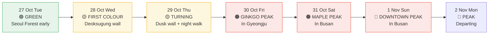

---
cssclasses:
  - korea-trip
---
# 🍂 Korea 2026 — Autumn foliage

[[Korea 2026 — Start Here|← Dashboard]] · [[Korea 2026 — Photography and Filming|Photography]] · [[Korea 2026 — Weather and Packing|Weather and packing]] · [[Korea 2026 — Itinerary|Itinerary]]

**You moved 20 days later to be here.** This note is the reasoning behind that decision, and an honest account of what it bought and what it did not.

## 📅 The forecast

Two forecasters, both autumn 2026, broadly agreeing:

| | K-Weather (17 Sep) | Korea Forest Service |
| --- | --- | --- |
| Central Korea first colour | 30 Sep – 18 Oct | — |
| **Central Korea peak** | **19 Oct – 1 Nov** | — |
| National ginkgo peak | — | **~30 Oct** |
| National maple peak | — | **~31 Oct** |
| Bukhansan | ~1 Nov | ~4 Nov (Weatheri) |
| Southern mountains | 1–11 Nov | Seoraksan ~25 Oct |

> [!info] Why the peak keeps sliding later
> The last five autumns ran about **2.3°C warmer in September and 1.4°C in October** than the 1990s baseline. Warm spells slow chlorophyll breakdown, so colour arrives later. Maple peak has shifted roughly **0.4 days per year**, ginkgo and oak about 0.5 — which means Seoul's classic ginkgo streets are now a late-October-to-mid-November event rather than a mid-October one. Your dates are on the right side of that trend.

## ✅ What your dates actually get you

| | Status on 27–29 Oct |
| --- | --- |
| Downtown parks | **Entering peak.** This is your window |
| Ginkgo street trees | **Turning to gold.** Peak 30 Oct, so you catch the change happening |
| Bukhansan ridges | First colour ~23 Oct — **starting** |
| Seoul's palaces | Autumn colour runs roughly 25 Oct – 5 Nov — **in season** |
| Sungkyunkwan's ginkgo | **The last tree in the city to turn** — into mid-November. Still green at your dates |
| Deep maple red | Missed. You will get turning, not peak |

**The honest summary:** you catch the trees **turning**, not at full colour. That is a real improvement over the original 17–23 October dates, when downtown Seoul would have been largely green and you would have caught only the Haneul Park silver grass — a festival that runs 17–23 October and therefore ends the day before you now land.

> [!danger] Two things that get missed at these dates
> **Changdeokgung's Secret Garden is at its best in the first week of November** — and its maples are the deepest in the city. Its Secret Garden is timed guided entry, booked online at **10:00 exactly six days ahead**, and sells out in three to five minutes. You chose the Hongdae vintage loop over it on Day 2; at 28 October the Secret Garden would have been early colour anyway. If you ever re-plan to early November, book it the moment the window opens.
>
> **Bukhansan peaks ~1–4 November**, a week after you leave. The Ui LRT reaches the east side; trails are steep and rocky and weekends are unmanageable.

---

## 🍂 The three stages

Autumn colour moves **down the mountain**, and each species follows its own clock.

| Stage | When | What |
| --- | --- | --- |
| **Mountain first** | Mid–late Oct | Bukhansan and Dobongsan ridges. 20% turned is "first colour", 80% is "peak" |
| **Palaces and city parks** | ~25 Oct – 5 Nov | The middle. Changdeokgung, Gyeongbokgung grounds, Seoul Forest |
| **Ginkgo avenues last** | Late Oct – mid-Nov | **34.7% of Seoul's street trees.** The whole city goes yellow at once, then it is over |

**Ginkgo is the signature of Seoul specifically.** Unlike maples, which you hike into mountains to see, ginkgo turns gold in the street. That is why a Seoul autumn day is a stroll rather than a climb. And it is also the risk: ginkgo goes fast — once a tree starts dropping it can be bare within days.

---

## 🚶 Six ginkgo walks — all free, all on the subway

| # | Walk | Station | Time | What to expect |
| --- | --- | --- | --- | --- |
| 1 | **Deoksugung wall & Jeongdong-gil** | City Hall, Line 1 | 30–40 min | **The classic.** Palace wall, ginkgo, zelkova, old churches. City rates this 0.3 km + 0.5 km. Best at warm late-afternoon light |
| 2 | **Samcheong-dong-gil** | Anguk, Line 3 | 40–60 min | 1.2 km up the east wall of Gyeongbokgung, lined with galleries and cafés. The same idea as #1 with coffee |
| 3 | **Sungkyunkwan's Munmyo ginkgo** | Hyehwa, Line 4 | 30 min | **Natural Monument No. 59. Planted 1519, about 21 m tall.** One tree, and it is the most moving single specimen in Seoul. Male, so no smelly berries |
| 4 | **Seoul Forest grove** | Seoul Forest, Line 2 | 30 min–1 h | **~600 ginkgo together.** Still had a golden carpet on 27 Nov 2025 — four weeks after peak. Your best late-season insurance |
| 5 | **Olympic Park, Wiryeseong-gil** | Olympic Park, Line 9 | 2 h | Longest walk at 2.7 km of ginkgo. Free, open 05:00–22:00. Big skies, a trek from downtown |
| 6 | **Sejong-daero** | Gwanghwamun | ~1 km | The spine between #1 and Gwanghwamun Square. Combines into one compact downtown loop |

> [!tip] The one-hour downtown loop, if you want the whole thing
> Start at **City Hall Station**, walk the Deoksugung wall down into Jeongdong-gil, then take Sejong-daero north back toward Gwanghwamun. Flat, central, Lines 1/2/5, and you get a palace wall, old churches and a full canopy in about an hour. **This is the best value in Seoul in late October** — and you are doing most of it already on Day 2.

### Where each walk lands in your plan

| Walk | When |
| --- | --- |
| **#1 Deoksugung wall** | Day 2, 11:45–13:00 — built in |
| **#1 again, at dusk** | Day 2 at ~17:00 if you skip the Hongdae loop, or Day 3 at 18:00 before the night walk |
| **#2 Samcheong-dong** | Day 2, lunch and the rest block |
| **#4 Seoul Forest** | Not currently on the plan. The natural swap for Hongdae if you want more trees than shops |
| **#3 Munmyo ginkgo** | **Not on the plan.** A 30-minute addition on Day 2 or a Day 3 evening option. See below |
| **#5 Olympic Park** | Not on the plan, and a long trip. Skip |

> [!tip] One genuine gap in the current plan, worth fixing
> **Sungkyunkwan's 1519 ginkgo is the single most remarkable tree you will pass**, and it is not on the itinerary. It is free, 30 minutes from Hyehwa Station on Line 4, and open from 9am. Two clean ways to add it:
> - **Day 3 evening** — take the DMZ swap mood instead: after the Jeongdong walk, ride Line 4 north to Hyehwa. Thirty minutes, back by 21:30.
> - **Day 2, swap the Hongdae loop** for Samcheong-dong → over the ridge → Sungkyunkwan → back down. You lose the vintage circuit and gain the best tree in Seoul.
>
> At your dates the tree will still be green — it is the **last** in the city to turn. But standing under a ginkgo planted in 1519 is worth the walk regardless of what colour it is. See [[Korea 2026 — Photography and Filming|shot ideas]].

---

## ⏰ Timing strategy for 27 October – 2 November

> [!warning] The peak lands while you are in Busan
> Ginkgo peaks nationally on **30 October** and maple on **31 October** — you are on the train to Busan and then in Busan on both. **Seoul's downtown peak (30 Oct – 8 Nov) is genuinely the best stretch of the year, and you are not in Seoul for it.** This is the cost of the route shape, and it was the right trade: arriving in Seoul and exiting through Busan is worth more than being in Seoul a week later.
>
> What you keep: the **onset** of downtown colour in Seoul on 28–29 Oct, which is quieter than peak and photographically cleaner. What you lose: peak. If you wanted peak badly enough, the honest fix is **Oct 29 – Nov 4** — four nights in Seoul during the peak, at the cost of the 3/1/2 split and Busan dropping to one night.

### The counter-intuitive trick

> [!tip] The fallen-leaf carpet photographs better than the leaves on the tree
> Multiple Korean sources make the same point: **a week after peak, when the leaves have carpeted the ground, is when the photographs actually turn out best.** Ginkgo that has fallen is a continuous gold field; ginkgo still on the branch is a scatter against sky. If you ever extend by three or four days, **Seoul Forest's grove is where you go late** — it was still golden on 27 November last year.
>
> **The day after rain is when leaves drop en masse.** If it rains on the 28th, the 29th's Deoksugung wall may be a carpet rather than a canopy. That is not a loss — it is a different and often better frame.

---

## 🌾 Outside Seoul

| Place | Peak | Note |
| --- | --- | --- |
| **Tongiljeon ginkgo road, Gyeongju** ⭐ | Late Oct – early Nov | **Bulb ginkgo**, unlike Seoul's trunked street trees — a whole avenue of them. Flat, free, close to your hanok. **Your Day 4** |
| **Bulguksa, Gyeongju** | Late Oct | Maples around the courtyards when colour arrives. On your Day 5 |
| **Daereungwon tombs, Gyeongju** | Late Oct | Mounds with maple. Your Day 4 |
| **Seoraksan** | ~20–25 Oct | The earliest peak in Korea, and 195 km away. Not reachable in your window |
| **Haedong Yonggungsa, Busan** | Late Oct | Coastal, milder. Day 6 |
| **Nami Island** | 25 Oct – 5 Nov | ₩18,000 including entry, 50 min from Cheongnyangni. A real option if you drop Seoul Forest |

> [!tip] Tongiljeon is the free substitute for a mountain day trip
> If you were tempted by Seoraksan — and the guide elsewhere rules it out as too far and too early — **Tongiljeon's ginkgo road is the answer.** It peaks late October into early November, which is exactly your Gyeongju night, it is flat rather than a hike, it is free, and it is close enough to walk to from Hwangnidan-gil. Seasonal timing shifts year to year, so check how it looks on arrival. [Search](https://www.google.com/maps/search/?api=1&query=통일전+은행나무길+경주)

> [!warning] Do not plan a Seoraksan day trip
> It is the best foliage in Korea and it peaks **before you arrive**. A round trip from Seoul is five to six hours of transport for a mountain that will already be past peak. This is the single most common mistake made by people planning Korea in late October.

---

## 🌡️ Colour conditions

| | Seoul | Gyeongju | Busan |
| --- | --- | --- | --- |
| Day | 12–16°C | 14–18°C | 18–20°C |
| **Night** | **6–10°C** | **5–9°C** | 11–13°C |

- October is Seoul's **driest month** — three to seven rain days, mostly brief, ~8.3 hrs daily sunshine
- KMA gave a **50% chance October runs warmer** than the 13.9–14.7°C normal, with precipitation near or below normal
- **Cloud is your friend for colour.** Overcast and post-rain light saturates yellow and red without blowing out; hard sun at midday flattens it. Shoot colour in the middle of the day, not at noon
- **Autumn nights in Seoul are the clearest air of the year** — night views are at their sharpest

> [!danger] The cold is the real cost of these dates
> You moved 20 days later for the foliage and gained roughly 3°C of night-time cold. Wolji Pond at 20:30, the Jeongdong walk, and Bulguksa at 08:30 are all cold outdoor events. **Gloves, not just a jacket.** See [[Korea 2026 — Weather and Packing|the full list]].

---

> [!quote] What these dates are actually worth
> Not peak colour. The **onset** of it, on weekdays, with no public holidays in November and a Korean city whose ginkgo is turning rather than already dropped. The photography is cleaner, the crowds are a fraction of peak week, and the cold is the price. A week later you would have had peak — and queues.

---

[[Korea 2026 — Start Here|← Dashboard]] · [[Korea 2026 — Photography and Filming|Photography]] · [[Korea 2026 — Itinerary|Itinerary]] · [[Korea 2026 — Map View|Maps]]