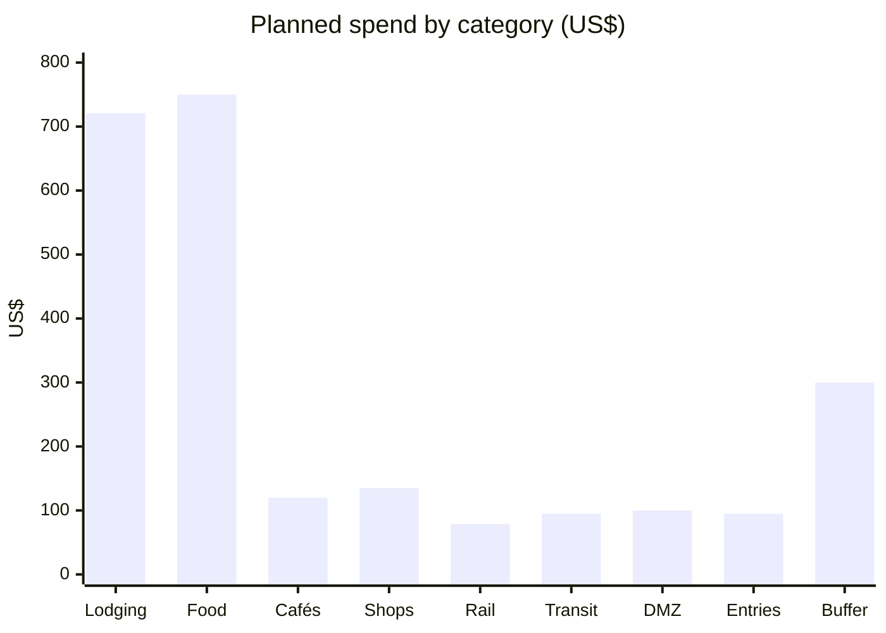

---
cssclasses:
  - korea-trip
---
# 💰 Korea 2026 — Budget

[[Korea 2026 — Start Here|← Dashboard]] · [[Korea 2026 — Bookings|Bookings]] · [[Korea 2026 — Itinerary|Itinerary]]

**Ceiling: US$2,500 working line.** The plan below comes to about **US$2,395**, which also fits a US$3,000 ceiling with roughly US$605 of discretionary headroom. International flights are excluded — they are a separate commitment, booked on a single ticket from PUS.

> [!info] Editable figures
> The **Planned** and **Actual** columns are Meta Bind fields. Click one and type over it as you book. If the fields render as plain text, Meta Bind is disabled — overwrite them by hand; nothing else changes.

---

## 📊 Live sheet

| Line | Planned | Actual | Note |
| --- | --- | --- | --- |
| Lodging — 6 nights | `INPUT[number(default:721)]` | `INPUT[number(default:0)]` | Hanok / guesthouse mix, two travelers |
| Food | `INPUT[number(default:750)]` | `INPUT[number(default:0)]` | ~US$105 a day |
| Cafés | `INPUT[number(default:120)]` | `INPUT[number(default:0)]` | Three cities |
| Records, books, listening room, tea | `INPUT[number(default:135)]` | `INPUT[number(default:0)]` | US$24 listening room + purchases |
| Intercity rail | `INPUT[number(default:79)]` | `INPUT[number(default:79)]` | **Regulated — will not change** |
| Local transit | `INPUT[number(default:95)]` | `INPUT[number(default:0)]` | T-money, AREX, PUS light rail |
| DMZ tour | `INPUT[number(default:100)]` | `INPUT[number(default:0)]` | US$42–60 pp |
| Entries | `INPUT[number(default:95)]` | `INPUT[number(default:0)]` | Cable cars, Bulguksa, Seokguram, Wolji |
| Contingency | `INPUT[number(default:300)]` | `INPUT[number(default:300)]` | Keep visible, do not pre-assign |

**Progress**
```tracker
searchType: task
searchTarget: '.*'
file: Korea 2026 — Budget.md
specifiedFilesOnly: true
bar:
```

> [!tip] What is fixed and what is not
> **Rail is fixed.** Korail sets KTX fares by regulation — ₩44,500 Seoul→Gyeongju and ₩10,100 Gyeongju→Busan, roughly US$79 for two, identical whether you book a month out or an hour before. **Lodging, tours, cafés and admissions are not** and will move. Budget the variable lines loosely and the rail line exactly.

> [!warning] Skip the KORAIL Pass on this route
> The two-day pass is ₩131,000 (~US$95). Your exact routing on separate tickets is ₩109,200 (~US$79) — about **US$16 cheaper**. The pass only pays off when a single travel day carries two long rides; yours has one each way. If you change the route to include a second day-trip, recalculate before dismissing it.

---

## 💵 Where the US$2,395 comes from

**Lodging — US$721**
Six nights at the hanok/guesthouse tier, two travelers. Seoul ~US$120 a night, Gyeongju ~US$109 inside Hwangnidan-gil, Busan ~US$109 a night, plus about 5% in taxes and fees. This is the line most likely to drift — book inside the working line or the rest has to give.

**Food — US$750**
Roughly US$105 a day for two across seven days. Korean eating is genuinely cheap outside the tourist strips; this covers breakfast, two proper meals and snacks without being careful.

**Cafés — US$120**
Three cities, roughly two stops a day at ₩6,000–12,000 each. Seoul's Garosu-gil and Busan's Seomyeon charge 20–30% more than residential streets.

**Records, books, listening room, tea class — US$135**
The [Wanita listening room](https://www.google.com/maps/search/?api=1&query=와니타음악감상실+성수+연무장17길) in Seongsu is ₩16,500 pp including your drink — about US$24 for two and the single most distinctive hour of the trip. Bitgguri's tea class is roughly US$10–20 pp. The rest is allowance for actual purchases.

**Intercity rail — US$79**
Two KTX legs, regulated fares, nothing to negotiate. See above.

**Local transit — US$95**
T-money top-ups for Seoul, Busan and Gyeongju, the AREX express from ICN (~US$14 for two), the Gyeongju station bus, and the Busan–Gimhae light rail. The PUS taxi upgrade adds US$22 if you take it instead.

**DMZ tour — US$100**
US$42–60 pp depending on the operator. Shuttle-only tickets run US$25–35 but exclude the tunnel and observatory admissions and the guide.

**Entries — US$95**
Yongdusan cable car, Bulguksa and Seokguram, Wolji Pond, Gyeongbokgung and the hanok-rental option. Palace entries are free or waived.

**Contingency — US$300**
Held deliberately unspent. Rain gear, a taxi when the light rail timing is wrong, an extra night of food if a booking slips.

---

## 📈 Shape of the spend



Lodging and food are **61% of the trip**. Cutting cafés or entries saves almost nothing; cutting a bad lodging night saves more than every discretionary line combined. If the budget tightens, fix lodging first and drop the shopping layer last.

---

## 🔎 What could move

| Line | Direction | Trigger |
| --- | --- | --- |
| Lodging | ↑ most likely | Peak foliage with no November holidays. Book now or pay more |
| DMZ tour | ↑ if late | US$78+ per person for morning departures with pickup at the last minute |
| Entries | ↑ small | Bulguksa currently free on VisitKorea but ₩6,000 on older tables — carry ₩10,000 |
| Rail | **Fixed** | Regulated. Nothing you do changes it |
| Food | ↓ likely | Skip the hanok rental dinner and you find a basement *mulbaegu* instead |
| Shopping | ↑ unbounded | See the luggage note below — this is a budget risk as much as a packing one |

> [!warning] Shopping is the line with no ceiling
> Korean second-hand prices are far higher than the reputation suggests: a Barbour jacket at Garosu-gil runs ~US$75, a Burberry trench ~US$75–220. Set a figure in [[Korea 2026 — Cafés and Shops|the shop list]] before you go and stick to it. **Immediate tax refund** applies over ₩15,000 at Global Tax Free stores with your passport, but only reduces the cost — it does not decide the purchase.

---

## ✅ Budget actions

- [ ] Decide the personal ceiling — US$2,500 working line, or US$3,000
- [ ] Set a hard spending cap on records and clothing before departure
- [ ] Confirm the CLP conversion rate and date you will use for comparison
- [ ] After each booking, write the real amount into the **Actual** column above and into [[Korea 2026 — Bookings|the reservation table]]
- [ ] One week before departure, re-run the total against the ceiling

> [!quote] The discipline that matters
> Compare **committed plus remaining estimated** against the ceiling, and include outstanding balances once. A paid amount is part of a reservation total, not an extra on top of it. Keep the reserve visible rather than assigning it to optional shopping — that is what makes a contingency still there when the weather turns.

---

[[Korea 2026 — Start Here|← Dashboard]] · [[Korea 2026 — Practical Info|Money, tax refund and luggage]]