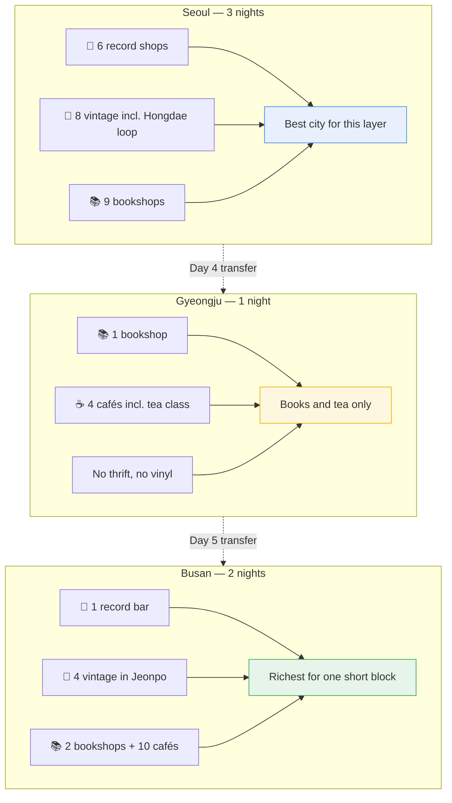

---
cssclasses:
  - korea-trip
---
# ☕ Korea 2026 — Cafés, thrift, books and records

[[Korea 2026 — Start Here|← Dashboard]] · [[Korea 2026 — Itinerary|Where each one fits]] · [[Korea 2026 — Maps|Maps index]] · [[Korea 2026 — Food|Food]]

**Compiled 7 October 2026.** Every entry has a working Google Maps search link built from the **Korean name plus the address** — not a place ID. Search the Hangul on the ground; it resolves reliably where an English name does not.

> [!warning] Hours here are a starting point, not a promise
> These came from operator listings and aggregator data, not from each shop. Small stores change closing days constantly and several are shut one day a week. **Check Naver Map or Google Maps the same morning.** The days below are what the listings said in October 2026.

> [!info] Prices are Korean second-hand prices, not thrift prices
> A Barbour jacket runs ~₩110,000 (US$75), a Burberry trench ~₩100,000–300,000 (US$75–220). Hongdae's warehouse halls are the cheap tier at ₩15,000–60,000 (US$11–43); Garosu-gil is the curated luxury tier. None of it is bargain-bin pricing.

---

## 🗺️ Which city has what

> [!warning] Gyeongju genuinely has no record or thrift scene
> It is a 130,000-person heritage city. The shopping culture is books, tea and bread. Nothing has been invented to fill the gap — if you want vinyl, Seoul and Busan are where you find it.

---

# Seoul

## 🎵 Records and listening rooms

| Place | Korean | Address | Hours | Cost | Map |
| --- | --- | --- | --- | --- | --- |
| **Wanita Listening Room** ⭐ | 와니타음악감상실 | 연무장17길 5 3.5층 · Seongsu Stn Exit 3, 3 min | Wkdy 14–22 / Wknd 13–22 | ₩16,500 pp incl. drink | [Search](https://www.google.com/maps/search/?api=1&query=와니타음악감상실+성수+연무장17길) |
| **Clique Records** | — | 을지로12길 8 삼진빌딩 3층 · Jung-gu | Tue–Fri 12–20 / Sat–Sun 13–20 · **closed Mon** | Free entry | [Search](https://www.google.com/maps/search/?api=1&query=Clique+Records+을지로12길+8+서울) |
| **TW Records** | — | 이태원로54길 5 2F · Yongsan-gu | Tue–Sun 12–20 · **closed Mon** | Free | [Search](https://www.google.com/maps/search/?api=1&query=TW+Records+이태원로54길+서울) |
| **Vinyl Seongsu** | 비닐성수 | 아차산로 15-8 | Wkdy 11–23 / Wknd 10–23 | Free | [Search](https://www.google.com/maps/search/?api=1&query=비닐성수+아차산로+15-8) |
| **The DISK** | — | 소공동 지하 58호 · underground mall, near Euljiro | Daily 13–20 | Cheap used | [Search](https://www.google.com/maps/search/?api=1&query=The+DISK+소공동+지하+서울) |
| **Seoul Record** | — | 삼성종로타워, 종로 1·2·3·4가동 | Daily 10–19:30 | Free | [Search](https://www.google.com/maps/search/?api=1&query=삼성종로타워+종로+record+store) |

> [!tip] Wanita is the one to give real time
> It is a **listening room**, not a shop — a dedicated room, vintage speakers, and a player who will put on what you ask for. ₩16,500 covers the room, the record and a drink. Roughly US$24 for two for about an hour. Multiple sources call it the quietest, most unusual thing to do in Seongsu. No booking; check Naver Map for closure days.
> 📍 **Not yet in the itinerary** — the strongest candidate if you swap out a café stop on Day 1 or want a Seongsu evening on Day 3.

> [!info] TW Records has a second site in Seongsu
> The TW Records label opened an LP store in the basement of the Mardi Mercredi Seongsu flagship on 18 September 2026, with listening sessions planned on site. The brand had not published the street address or the basement hours as of early October — search for it on arrival rather than planning around it.

## 👕 Vintage and thrift

Four distinct clusters. They are **not interchangeable** and this trip only visits one properly.

| Place | Korean | Address | Hours | Notes | Map |
| --- | --- | --- | --- | --- | --- |
| **Gwangjang Market 2F** ⭐ | 광장시장 2층 | Follow the red **수입구제** signs upstairs | ~09–23 | 50–80 indie stalls, ₩20,000–300,000. **Already on your Day 1 dinner route** | [Search](https://www.google.com/maps/search/?api=1&query=광장시장+2층+수입구제+빈티지) |
| **Page-One** ⭐ | — | 04049 동막로 75, Mapo-gu · Sangsu Stn Exit 1, 50 m | Mon 13:00–19:55 / Tue–Thu 12:30–20:50 / Fri–Sun 13:00–20:50 | Official Visit Seoul featured shop | [Search](https://www.google.com/maps/search/?api=1&query=Page-One+빈티지+동막로+75+상수) |
| **ROOT HONGDAE** ⭐ | 루트 홍대 | 동교동 162 15 지하1층 | — | Three floors, clean layout, real fitting rooms. **Budget two to three hours** | [Search](https://www.google.com/maps/search/?api=1&query=ROOT+HONGDAE+동교동) |
| **Hongdae Vintage B1** | 홍대빈티지 B1 | 서교동 358-58 지하층 | Mon–Thu 11–23 / Fri–Sat 11–24 / Sun 11–23 | Warehouse hall. **Open late — this is why the loop works on Day 2** | [Search](https://www.google.com/maps/search/?api=1&query=홍대빈티지+B1+서교동) |
| **Mildboy** | 마일드보이 | 동교동 162 3 지하1층 | Mon–Tue & Fri–Sun 13–22 · **closed Wed–Thu** | Beside ROOT — but shut on your Day 2 | [Search](https://www.google.com/maps/search/?api=1&query=마일드보이+동교동+빈티지) |
| **AIR vintage** | AIR vintage | 연무장길 39 지하1층 · Seongsu | Daily 12–21 | 5.0 from 360 reviews | [Search](https://www.google.com/maps/search/?api=1&query=AIR+vintage+연무장길+39+성수) |
| **Balbal Vintage** | 발발빈티지 신사점 | 가로수길 41 B1–B3 · Sinsa Stn Exit 8, beside Apple Store | Daily 12:30–21:30 | B1 luxury · B2 street · B3 Polo/Barbour/Burberry. 5.0 from **1,116** reviews | [Search](https://www.google.com/maps/search/?api=1&query=발발빈티지+신사점+가로수길+41) |
| **Dongmyo flea market** | 동묘시장 | Near Dongmyo Stn | **Sat–Sun 10:00 only** | ₩1,000–15,000 raw hunting. **Your Seoul days are Tue–Wed–Thu — it does not fit** | [Search](https://www.google.com/maps/search/?api=1&query=동묘시장+벼룩시장) |

**Price tiers** — Dongmyo ₩1,000–15,000 · Hongdae/Yeonnam ₩15,000–80,000 · Gwangjang 2F ₩20,000–300,000 · Garosu-gil ₩30,000+

> [!warning] The Hongdae loop is the only cluster on this itinerary
> Page-One, ROOT, Hongdae Vintage B1 and Yeonnam-dong all sit within one walking stretch from Hongik University Station Exits 8/9. **Garosu-gil and Garosu-gil's side alleys are 45 minutes each way** and are not on the plan. Balbal is listed for completeness, not as an expectation.
>
> 🗺️ The Dongmyo flea market is **weekends only** and your Seoul days are weekdays. The permanent covered arcade shops next to it open daily — a different experience, not the flea market.

## 📚 Bookshops

| Place | Korean | Address | Hours | Notes | Map |
| --- | --- | --- | --- | --- | --- |
| **Boan Books** ⭐ | 보안서점 | 사직동 효자로 33 2F · 10 min from Gyeongbokgung Stn Exit 3 | Tue–Sun 12–19 · **closed Mon** | 1942 inn, glass bridge, palace-wall view. Art, humanities, indie magazines | [Search](https://www.google.com/maps/search/?api=1&query=보안서점+효자로+33+사직동) |
| **Dae-o Bookstore** ⭐ | 대오서점 | 350 m from Boan Books | — | **Seoul's oldest bookshop**, preserved as a café. ₩7,000 entry incl. drink | [Search](https://www.google.com/maps/search/?api=1&query=대오서점+서울+사직동) |
| **Jongno Seojeok** | 종로서적 | 종로타워 지하, Jong-ro | Daily 10–22 | 1,417 reviews — the most-read bookshop on any list here | [Search](https://www.google.com/maps/search/?api=1&query=종로서적+종로타워+지하) |
| **Dongne Chaekbang alley** | 동네책방 골목 | Jangchung-dong · Jangchungdanil Stn | Daytime | Founded by Korean War refugees; a narrow alley of used-book stalls, English paperbacks from ₩3,000 | [Search](https://www.google.com/maps/search/?api=1&query=장충동+동네책방+골목) |
| **Post Poetics** ⭐ | — | Hannam-dong, Yongsan-gu | — | **English-language art books only** — photography, film, architecture, fashion, music | [Search](https://www.google.com/maps/search/?api=1&query=Post+Poetics+bookstore+Hannam-dong+서울) |
| **Music Complex** | — | 인사동길 49, Insadong | Mon–Fri 12–24 / Sat–Sun 10–24 | Café **and** record store, **open till midnight** | [Search](https://www.google.com/maps/search/?api=1&query=Music+Complex+Seoul+인사동길+49) |
| **Thanks Books** | — | Hongdae · 7 min from Hapjeong Stn | — | Book-café, monthly design curation, warm yellow interior | [Search](https://www.google.com/maps/search/?api=1&query=Thanks+Books+Hongdae+합정) |
| **Sehwa's English Bookstore** | — | Gireum Stn Exit 7 · Line 4 | 11:00–21:30 | Used English from ₩3,000. 65% of customers are foreign | [Search](https://www.google.com/maps/search/?api=1&query=Sehwa's+English+Bookstore+기림역+서울) |
| **Ink & Feather** | — | Seocho Stn, Line 2 | 10:00–20:00 | Korea's largest English-only, 40,000+ titles. **Also has a Busan branch** | [Search](https://www.google.com/maps/search/?api=1&query=Ink+and+Feather+서초+서울) |

## ☕ Cafés

| Place | Korean | Address | Notes | Map |
| --- | --- | --- | --- | --- |
| **Dalkom** ⭐ | — | Ikseon-dong | Walnut cake, famous, sells out early | [Search](https://www.google.com/maps/search/?api=1&query=달콤+익선동) |
| **책익다** ⭐ | 책익다 | 서교동 와우산로29마길 10-3 | Bookshop that is also a bar — read with a beer, whisky or wine. Quiet enough that you cannot talk | [Search](https://www.google.com/maps/search/?api=1&query=책익다+서교동+와우산로29마길) |
| **Cafe Masuk** | — | Seochon | Not verified in this pass — check Maps before relying on it | [Search](https://www.google.com/maps/search/?api=1&query=카페+마수+서촌) |

> [!info] Seoul's café layer is deliberately light here
> The three cities concentrate their scenes differently: Busan and Gyeongju's shopping streets are themselves café streets, while Seoul's cafés were already covered day by day in [[Korea 2026 — Itinerary|the itinerary]]. Anything I could not verify is marked rather than listed as fact.

---

# Gyeongju

## 📚 Books and ☕ tea — the Hwangnidan-gil block

All four sit within a few minutes' walk of each other on Hwangnidan-gil, which is why Day 4 works as one continuous block.

| Place | Korean | Address | Hours | Notes | Map |
| --- | --- | --- | --- | --- | --- |
| **Eoseoseo** ⭐ | 어서어서 | 포석로 1083, 황남동 | Mon–Fri 11:00–19:30 / **Sat–Sun 10:00–21:00** | Independent literary bookshop. Purchases wrapped in "읽는 약" (*medicine to read*) envelopes. 4.2 from 212 reviews | [Search](https://www.google.com/maps/search/?api=1&query=어서어서+서점+경주+황리단길) |
| **Bitgguri** ⭐ | 빗꾸리 | 손효자길 16-1 | — | Renovated century-old hanok teahouse. Grain syrup with saekdong rice cake. **One-day tea classes** · +82-54-777-4421 | [Search](https://www.google.com/maps/search/?api=1&query=빗꾸리+경주+손효자길+한옥+찻집) |
| **Kkachiseom** ⭐ | 꼬치섬 | 손효자길 21 2F | 10:30–19:00 · **closed Tuesdays** | Second-floor hanok café with an unobstructed view down onto Daereungwon's tomb mounds. Cloud Einspänner ~US$4, monaka ~US$2 | [Search](https://www.google.com/maps/search/?api=1&query=꼬치섬+경주+황리단길+카페) |
| **NuMaru Hanok Cafe** | 누마루 한옥카페 | Bulguksinjae 2-gil | Daily 10:00–22:00 | 4.4 from 327 reviews | [Search](https://www.google.com/maps/search/?api=1&query=누마루+한옥카페+경주) |

> [!warning] Call Bitgguri a day ahead for the tea class
> It is a one-person operation in a small hanok. Arrive without booking and you get tea, which is still lovely — but not the class.

> [!tip] Do these in the order they appear on the street
> Bookshop first while it is bright, café second while you want a seat, teahouse last if you have committed to a class. They are four minutes apart, so the order barely matters.

**Other cafés on Hwangnidan-gil**, all rated 4.4–4.9 in October 2026 listings: 라떼갤러리 · Cafe Arae Heon · Dimension Coffee · 카페 다시 봄 · Cafe Maple · 묵정갤러리&커피 · Cafe Asa · Sotheby · 코지브릭. [Search the street](https://www.google.com/maps/search/?api=1&query=황리단길+카페+경주)

---

# Busan

Two clusters on opposite sides of the city. **This trip takes Millak-dong** — it pairs records, books and cafés with the coast in one walkable area.

## Cluster A — Millak-dong ⭐ *(your Day 6 afternoon)*

| Place | Korean | Address | Hours | Notes | Map |
| --- | --- | --- | --- | --- | --- |
| **Cafe Voisin** ⭐ | — | Millak-dong, beside the old Okcheontang public bath | — | **Your landmark.** Pointed roof, floor-to-ceiling glass, "we serve coffee" over a bath pictogram | [Search](https://www.google.com/maps/search/?api=1&query=Cafe+Voisin+밀락동+부산) |
| **Dopamine Records** ⭐ | 도파민레코드 | 밀락로14번길 28 2층 | — | Record bar, 5.0, in the middle of the café street | [Search](https://www.google.com/maps/search/?api=1&query=도파민레코드+밀락로14번길) |
| **Casual Book Shop** | — | Millak-dong, apricot-tiled building | — | Bookshop-café, named in Busan's official city guide | [Search](https://www.google.com/maps/search/?api=1&query=Casual+Book+Shop+밀락동+부산) |
| **Dambug** | 담벅 | 우동 1468번지 1804호, 해운대구 | — | Bookshop, 5.0 | [Search](https://www.google.com/maps/search/?api=1&query=담벅+도서관+우동+해운대) |
| **MILLAC THE MARKET** ⭐ | 밀락더마켓 | 밀락수변로17번길 56, Suyeong-gu | **Daily 10:00–24:00** | 7,722 m² hall, busking square. **The reliable fallback** when three cafés are mysteriously shut | [Search](https://www.google.com/maps/search/?api=1&query=밀락더마켓+MILLAC+THE+MARKET) |
| **Waveon Coffee** ⭐ | — | Gwangalli | — | 1920s Japanese-style villa. The best building in Busan | [Search](https://www.google.com/maps/search/?api=1&query=Waveon+Coffee+광안리+부산) |
| **Eletro Look** | 일레트로룩스 | 우동 1495번지 7층, 해운대구 | — | Café, 5.0 | [Search](https://www.google.com/maps/search/?api=1&query=일레트로룩스+밀락동+부산) |

> [!tip] How to walk Millak-dong
> Enter from the Gwangalli end. Cafe Voisin's bath pictogram is visible from three corners away, so find it first, work outward to Dopamine Records and Casual Book Shop, then cross to MILLAC when your feet hurt. The whole cluster is walkable; a taxi takes ten minutes from Seomyeon.

## Cluster B — Jeonpo-dong *(not on the plan, listed for completeness)*

| Place | Korean | Address | Hours | Notes | Map |
| --- | --- | --- | --- | --- | --- |
| **Vintage 38** | — | 전포대로199번길 38 | **24 hours** | Industrial café with a wall of vinyl, vintage electronics and toys. Open when everything else is shut | [Search](https://www.google.com/maps/search/?api=1&query=Vintage+38+전포대로199번길+부산) |
| **ATHWART** | 어쏘워트빈티지 | 서전로58번길 64 | Daily 12–21 | 5.0 | [Search](https://www.google.com/maps/search/?api=1&query=어쏘워트빈티지+서전로58번길+부산) |
| **WEBBY** | 웨비 | 전포대로223번길 19 A동 118호 | Mon–Wed & Fri 13–19 / Sat–Sun 12–20 · **closed Thu** | | [Search](https://www.google.com/maps/search/?api=1&query=웨비+빈티지+전포대로223번길) |
| **kikie Vintage** | 키키빈티지 | 전포대로186번길 16 지하1층 | Mon & Wed–Sun 12–19 · **closed Tue** | 5.0 | [Search](https://www.google.com/maps/search/?api=1&query=키키빈티지+전포대로186번길) |
| **Young Archive Jeonpo** | — | 동성로 17 1F · upper Jeonpo | — | Art-exhibition-style studio with analog props and photo zones | [Search](https://www.google.com/maps/search/?api=1&query=Young+Archive+Jeonpo+동성로+17+부산) |
| **MOODY BREAD MARKET** | — | 전포대로216번길 22 | — | Bread and sandwiches, 1F and 2F. Good breakfast | [Search](https://www.google.com/maps/search/?api=1&query=MOODY+BREAD+MARKET+전포대로216번길) |
| **Knockout** | 넉아웃 | 부전동 168-280 | Day → night | Vintage café by day, bar by night, rooftop. Chocolate cake ₩7,000 | [Search](https://www.google.com/maps/search/?api=1&query=넉아웃+Knockout+부전동+부산) |

**More Jeonpo cafés** — *Toi et moi* (전포대로176번길 40) · *TOT* (동성로15번길 18) · *Quant a moi* (동성로25번길 26-1, croissants) · *PONG PONG* (동성로15번길 24, focaccia) · *FRUTO FRUTA* (전포대로224번길 28) · *14wagon* (동성로87번길 9)

---

## 🎒 Practical notes for this layer

> [!warning] Bring a foldable bag, or plan to ship
> Second-hand shopping on a six-night trip fights the luggage you brought. Korea has same-day and next-day courier (택배) from any convenience store — buy a box, fill it, send it home. This is cheaper and safer than trying to fit a wardrobe into a carry-on allowance.

> [!tip] Tax refund needs the passport you brought for the DMZ
> Immediate refund on purchases over ₩15,000 at Global Tax Free stores. It lowers the cost of what you buy. It does not decide whether to buy it.

> [!info] Set a number before you land
> Korean vintage is a genuine rabbit hole and the prices are not low. Decide your ceiling in [[Korea 2026 — Budget|the budget note]] before departure, not at the till.

---

[[Korea 2026 — Start Here|← Dashboard]] · [[Korea 2026 — Itinerary|Day-by-day]] · [[Korea 2026 — Maps|Every Maps search]] · [[Korea 2026 — Food|Eating]]