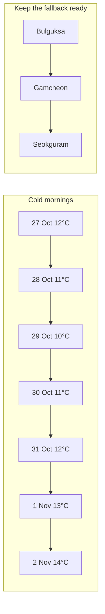

---
cssclasses:
  - korea-trip
---
# 📱 Korea 2026 — Daily pocket cards

[[Korea 2026 — Start Here|← Dashboard]] · [[Korea 2026 — Itinerary|Full itinerary]] · [[Korea 2026 — Maps|Maps index]]

**One compact card per travel date.** Open the day's card on the morning and you have the whole plan without scrolling through the itinerary. Each carries its anchors, its Maps search, its food, its cut, and the three things to do before leaving.

| # | Date | Weekday | Card | Anchor | Density |
| --- | --- | --- | --- | --- | --- |
| 1 | 27 Oct | Tue | [[Korea 2026 — Pocket 2026-10-27\|Arrival + Ikseon-dong]] | Arrive and recover | 🟢 Light |
| 2 | 28 Oct | Wed | [[Korea 2026 — Pocket 2026-10-28\|Palaces + Hongdae vintage]] | Gyeongbokgung at 09:30 | 🟡 Full |
| 3 | 29 Oct | Thu | [[Korea 2026 — Pocket 2026-10-29\|DMZ + night walk]] | The 07:30 coach | 🟡 Full |
| 4 | 30 Oct | Fri | [[Korea 2026 — Pocket 2026-10-30\|Seoul → Gyeongju]] | Wolji Pond after dark | 🟢 Medium |
| 5 | 31 Oct | Sat | [[Korea 2026 — Pocket 2026-10-31\|Bulguksa → Busan]] | Bulguksa at 08:30 | 🟡 Full |
| 6 | 1 Nov | Sun | [[Korea 2026 — Pocket 2026-11-01\|Gamcheon + Millak-dong]] | Gamcheon before 10:00 | 🟠 Densest |
| 7 | 2 Nov | Mon | [[Korea 2026 — Pocket 2026-11-02\|Depart PUS]] | One ticket home | 🟢 Light |

> [!tip] The cards are the trip, not a summary of it
> They are written to be usable standing up with a phone in one hand. If a card and the full itinerary ever disagree, **the card is the shortlist** and the itinerary is the reasoning.

## 🌡️ The week at a glance

The wettest-looking window sits just before departure. **Check the ten-day forecast on 22 October** and pick your rain fallback then, not on the day.

## 📌 Standing items — every day

- [ ] Photograph the accommodation address **in Korean** and keep it offline
- [ ] Keep one ₩20,000 note for taxis, temples and small shops
- [ ] Back up photos in the evening; it is the only quiet moment you get
- [ ] Check tomorrow's card the night before, not the morning of
- [ ] T-money topped up — convenience stores are open late and everywhere

---

> [!info] Where the cuts are
> **Day 2** — drop the Hongdae loop, keep Yeonnam-dong. **Day 6** — drop Haedong Yonggungsa, keep Gwangalli at sunset. Both are marked on their cards. Neither costs you anything you cannot see another day.

[[Korea 2026 — Start Here|← Dashboard]] · [[Korea 2026 — Itinerary|Full itinerary]] · [[Korea 2026 — Weather and Packing|Weather and packing]]