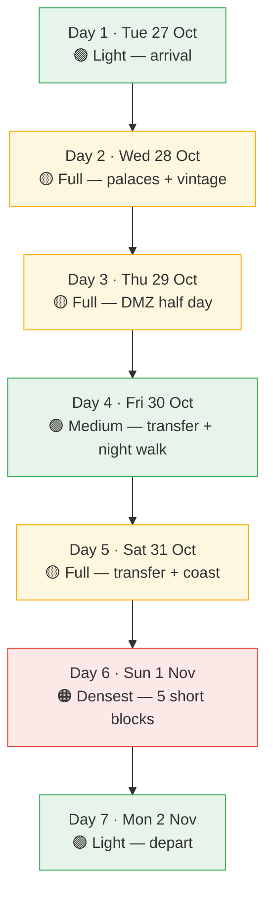

---
cssclasses:
  - korea-trip
---
# 📖 Korea 2026 — Itinerary

[[Korea 2026 — Start Here|← Dashboard]] · [[Korea 2026 — Daily Pocket Cards|Pocket cards]] · [[Korea 2026 — Bookings|Bookings]] · [[Korea 2026 — Budget|Budget]]

**Six nights, 27 October – 2 November 2026. Two travelers. Balanced pace — two or three anchors a day with real gaps between them.** Every row has a backup you can take instead.

**Before you use this:** the density of each day is marked below. If a day feels like too much, the named cut is the thing to take out.

## 🚪 Check the day before you go

| Day | Weekday | Gyeongbokgung | Changdeokgung · Deoksugung · Changgyeonggung |
| --- | --- | --- | --- |
| 27 Oct | Tue | ⚠️ **CLOSED** | Open |
| 28 Oct | Wed | Open | Open |
| 29 Oct | Thu | Open | Open |
| 30 Oct | Fri | Open | Open |
| 31 Oct | Sat | Open | Open |
| 1 Nov | Sun | Open | Open |
| 2 Nov | Mon | Open | ⚠️ **CLOSED** |

> [!danger] The palaces do not share a closing day
> **Gyeongbokgung closes Tuesdays. Changdeokgung, Deoksugung and Changgyeonggung close Mondays.** You land on **Tuesday 27 October** — the one day Gyeongbokgung is shut. The plan avoids it by visiting on Wednesday the 28th, so there is no problem **as written**. But if anything slides a day earlier, or you decide to see the palace on arrival, you will arrive at a locked gate on the day you land. Gyeongbokgung is also closed on the third Tuesday of every month for a royal guard ceremony — worth a final check on the palace's own site in the week before you fly.

> [!warning] Deoksugung is your after-dark palace
> Deoksugung is open **until 21:00** (last entry 20:00) for ₩1,000, which makes it the only palace you can photograph lit in this window. **Gyeongbokgung's autumn night viewing ended on 2 October 2026** — you miss it entirely, so do not plan an evening there. If you want a palace after dark, it is Deoksugung.

---

## 📊 How the days are weighted

> [!tip] Your two cuttable moments
> **Day 2** — drop the Hongdae loop and keep only Yeonnam-dong. Same neighbourhood, no 30-minute transit, calmer. **Day 6** — drop Haedong Yonggungsa and keep Gwangalli at sunset. Nothing is lost that you cannot get back later.

---

## Day 1 · Tue 27 October — Arrival and Ikseon-dong

**Base: Euljiro / Ikseon-dong · night 1 · density: light, deliberately**

The flight is around 24 hours door to door. Do not schedule anything that needs concentration.

| Time | Activity | Neighborhood | Transport | Cost | Booking | Backup |
| --- | --- | --- | --- | --- | --- | --- |
| ~07:00 | Land ICN T1 · immigration · AREX express | — | AREX 43 min · ₩9,500 | US$14 | — | Buy T-money at the ARR kiosk |
| 10:00 | Drop bags — check-in is 15:00, so just store them | Euljiro | Walk | — | Lodging | — |
| 11:00 | Late brunch | Euljiro | Walk | US$12–18 | — | — |
| 14:00–17:00 | **Ikseon-dong** + **Gyeongui Line Forest Park** | Ikseon-dong | Walk 12 min | US$6–10 café | — | Seochon Hanok Village, 5 min south |
| 17:30 | Rest | Euljiro | — | — | — | — |
| 19:00 | Dinner, then the market's 2F vintage floor | Gwangjang Market | Walk | US$30–45 | — | — |
| 21:00 | Records, if you still have it in you | Euljiro / Sogong-dong | Walk | Free | — | Skip it |

**Why Ikseon-dong:** 1930s hanok blocks now full of design cafés, and the elevated park walkway looks straight down onto the rail lines. It is the best free photography in central Seoul and almost nobody is there early afternoon. The Gyeongui Line forest walk runs from Hoehyeong along the tracks.

> [!tip] Go up two floors at Gwangjang Market
> Follow the red **수입구제** signs to the second floor. Fifty to eighty independent vintage stalls, ₩20,000–300,000, and almost no tourists. You are already there for dinner, so it costs nothing extra.

**🍽 Food** — *Makdong Toseong*, Junghwang-dong: halal Korean, order **gukbap** and ask for the vegetable pot · **Dalkom**, Ikseon-dong: walnut cake, famous, go early · **Gwangjang Market**: **bindaetteok** and **tteokbokki** at the older stalls, ask plainly for no meat or saké in the sauce

📍 [Gwangjang Market 2F](https://www.google.com/maps/search/?api=1&query=광장시장+2층+수입구제+빈티지) · [[Korea 2026 — Cafés and Shops|More on Ikseon-dong and Euljiro]]

---

## Day 2 · Wed 28 October — Palaces, Jongno bookshops, Hongdae vintage

**Base: Jongno / Samcheong-dong · night 2 · density: full**

Both vintage stops close late — Page-One at 20:50, Hongdae B1 at 23:00 — so the shopping happens after the crowds thin out.

| Time | Activity | Neighborhood | Transport | Cost | Booking | Backup |
| --- | --- | --- | --- | --- | --- | --- |
| 09:30–11:30 | **Gyeongbokgung Palace** — free; hanbok rental waives entry | Jongno | Bus 29 or walk | US$4 (US$30 with hanbok) | — | Skip hanbok, the palace is the point |
| 11:45–13:00 | **Deoksugung Stone Wall Path** + the palace itself | Jongno | Walk 8 min | Free (₩1,000 inside) | — | Tapgol Park, same walk |
| 13:00 | Lunch | Samcheong-dong | Walk | US$25–35 | — | — |
| 14:00–15:30 | **Boan Books** + **Dae-o Bookstore** | Sajik-dong | Walk 10 min | US$5 entry | — | [[Korea 2026 — Cafés and Shops\|Other Jongno bookshops]], incl. Jongno Seojeok (till 22:00) |
| 15:30–17:30 | **Rest block** — keep this | Samcheong-dong | — | — | — | — |
| 18:00–20:00 | **Hongdae vintage loop** | Hongdae | Line 3 → Line 2, ~30 min | Free | — | Yeonnam-dong only |
| 20:00–21:30 | Dinner and a café | Yeonnam-dong | Walk | US$35–50 | — | — |

**Why the stone wall path instead of more palace:** same Joseon era, a tenth of the crowd, and the elevated granite walkway between Deoksugung and Tapgol is genuinely better photographed than standing in a second courtyard. Gyeongbokgung at 09:30 catches the light through the gates before the tour groups land.

**Deoksugung is open until 21:00** (₩1,000, last entry 20:00). That makes it the one palace you can come back to in the evening — and it is the correct after-dark palace for this window, since Gyeongbokgung's autumn night viewing ended on 2 October, before the colour. If tomorrow's Jeongdong walk goes well and you have energy, this is the obvious add. See [[Korea 2026 — Photography and Filming|shot ideas]].

> [!tip] Hanbok is a discount, not a costume
> Wearing hanbok waives Gyeongbokgung and several other palaces' admission. The rental is roughly US$25–30 and they are pressed and ready in about twenty minutes. Buy it, wear it, return it. It is the cheapest upgrade in Seoul.

**📚 Bookshops** — **Boan Books** (보안서점, 효자로 33 2F) is a 1942 inn with a glass bridge to the modern wing and a view of the palace walls; art, humanities and indie magazines, closed Mondays. **Dae-o Bookstore** is 350 m away — Seoul's oldest bookshop, preserved as a café, ₩7,000 entry including a drink. [Boan](https://www.google.com/maps/search/?api=1&query=보안서점+효자로+33+사직동) · [Dae-o](https://www.google.com/maps/search/?api=1&query=대오서점+서울+사직동)

**👕 The Hongdae loop** — all within a short walk of Hongik University Station Exit 8/9: [Page-One](https://www.google.com/maps/search/?api=1&query=Page-One+빈티지+동막로+75+상수) (official Visit Seoul featured; women's 1F, brand-name 2F, closes 20:50) · [ROOT HONGDAE](https://www.google.com/maps/search/?api=1&query=ROOT+HONGDAE+동교동) (three floors, clean, real fitting rooms — budget two hours) · [Hongdae Vintage B1](https://www.google.com/maps/search/?api=1&query=홍대빈티지+B1+서교동) (warehouse hall, open till 23:00). Then **Yeonnam-dong** ten minutes north, where the micro-shops carry Japanese workwear and linen at a fraction of Hongdae's noise.

> [!warning] Mildboy is closed Wednesday and Thursday
> It sits right beside ROOT and will look tempting. It is shut. Do not plan around it.

**🍽 Food** — *Sajae* (사재), Samcheong-dong: traditional set menus, easy to make vegetable-forward · **Jejugo** (제주고), Insadong · **책익다**, Seochon: a bookshop that is also a bar — read with a beer, whisky or wine. Reviews warn it is quiet enough that you cannot talk, which is exactly right at 21:00. [Map](https://www.google.com/maps/search/?api=1&query=책익다+서교동+와우산로29마길)

---

## Day 3 · Thu 29 October — DMZ and the Jeongdong night walk

**Base: back in Seoul · night 3 · density: full, but the afternoon is free**

| Time | Activity | Neighborhood | Transport | Cost | Booking | Backup |
| --- | --- | --- | --- | --- | --- | --- |
| 07:30 | Tour pickup ⚠️ | — | Coach | — | **Booked** | See the swap below |
| 08:30–12:30 | **DMZ: Imjingak → Freedom Bridge → 3rd Infiltration Tunnel → Dora Observatory** | Paju / DMZ | Included | US$100 | **Passport in hand** | — |
| 13:30 | Drop-off | City Hall | Coach | — | — | — |
| 14:00–17:00 | **Downtime — actually take it** | Euljiro | Metro | US$20–30 lunch | — | Return and sleep |
| 19:00–21:00 | **Jeongdong Night Walk** ⭐ | Deoksugung | Walk 10 min | Free | Runs 29–31 Oct | Cheonggyecheon |
| late | Records, if the evening allows | Insadong / Jongno | Walk | Free | — | Skip |

**What the DMZ actually is.** At Imjingak, the Mangbaedan altar is where families separated in 1950 still pray north. The Third Infiltration Tunnel is 73 metres underground and 265 metres long, cut north from North Korea in 1978 — you walk down into it and back up. Dora Observatory gives you a binocular view of Kijŏng-dong across the DMZ on a clear day. It is history, not a spectacle.

> [!warning] You are catching the warm-up night, not the opening
> Jeongdong Night Walk runs **30–31 October**, with **warm-up events on the 29th** and the **official opening concert at 19:00 on the 30th**. The 29th is a warm-up: the wall is lit and the programme is running, but the opening-night staging is not in place. That is a fair trade for having the DMZ on a weekday — and the wall itself is the point, not the concert.
>
> ⚠️ **The 30th and 31st pack the narrow path.** You are on the 29th, so you have the quiet version. If the DMZ ever moves to a later date, the crowd problem arrives with it.
>
> 💡 **Shoot it in daylight first.** The gold ginkgo along the wall photographs far better at 17:00 than under night lighting — and you will be walking this same wall on Day 2.

> [!danger] Passport required, and checked twice
> The tour operator needs your passport details when you book, and the military checkpoint checks the physical document on the day. Copies are refused.

> [!tip] The swap if the DMZ is cancelled
> Military access is genuinely discretionary and tours do get cancelled. The fallback is better in some ways and needs **no tour and no passport**: take the Gyeongui Line to **Imjingang** at your own pace, eat vegetarian *sot bap* at **Baegyangsa Temple** (₩12,000, reserve with the temple a day ahead), then walk **Paju Book House** and the drop village **Odogae**. It is north Seoul, quiet, and nobody is on a coach.

**Evening** — [Music Complex Seoul](https://www.google.com/maps/search/?api=1&query=Music+Complex+Seoul+인사동길+49) is a café and record store open **until midnight**, five minutes from where the tour drops you. [[Korea 2026 — Cafés and Shops|Jongno Seojeok]] is open till 22:00. [Post Poetics](https://www.google.com/maps/search/?api=1&query=Post+Poetics+bookstore+Hannam-dong+서울) in Hannam-dong sells English-language art books — photography, film, architecture, fashion, music.

**🍽 Food** — *Sajung noodles* in a City Hall basement *mulbaegu*: order **bibim-mul** with a fried egg and no meat · **Eonnae Handaxe** (은애한식), Euljiro: banchan-forward, the easiest vegetarian dinner in Seoul

---

## Day 4 · Fri 30 October — Seoul to Gyeongju

**Base: Gyeongju hanok near Hwangnidan-gil · night 4 · density: medium**

Book the Gyeongju lodging **inside Hwangnidan-gil**. It is the difference between walking home from Wolji Pond at 22:00 and a taxi.

| Time | Activity | Neighborhood | Transport | Cost | Booking | Backup |
| --- | --- | --- | --- | --- | --- | --- |
| 09:30 | Check out → Seoul Station | Euljiro | Line 2 | — | — | — |
| 10:30–12:45 | **KTX to Gyeongju** | on board | ₩44,500 pp | US$64 | **Booked** | — |
| 13:15 | Bus into town | → Hwangnam-dong | Bus 50/51/70 · ₩1,500 | US$2 | — | Taxi ₩15,000, saves 20 min |
| 14:00 | Drop bags at the hanok | Hwangnidan-gil | Walk | — | **Booked** | — |
| 15:00–17:00 | **Daereungwon** tombs + **Hwangnidan-gil** | Hwangnam-dong | Walk | US$8–12 | — | Gyeongju National Museum — free, I. M. Pei building, rain-proof |
| 17:30 | **Cheomseongdae** — free, open till 22:00 | Hwangnam-dong | Walk 5 min | Free | — | — |
| 19:00 | Dinner | Hwangnidan-gil | Walk | US$25–40 | — | — |
| 20:30–22:00 | **Woljeongyo Bridge** lit → **Donggung and Wolji Pond** | Donggung / Wolji | Walk 10 min | US$5 | — | Woljeongyo alone, free |

**This night is the reason to stop in Gyeongju at all.** Woljeongyo is a restored Unified Silla wooden bridge over the Namcheon, free, lit until 22:00. Wolji Pond is the city's signature image — pavilions reflected in still water — ₩3,000, last entry 21:30. Come at dusk, not at lunch. A day trip from Seoul cannot do this without watching the clock.

> [!warning] Check your ticket's station name
> Current Wikidata and OpenStreetMap data both place the KTX stop at **경주역**, 35.798, 129.139, and treat 경주역 and 신경주역 as the same location. Older guides still say Singyeongju, and that is where the confusion comes from. Either way the town is ~12 km out: buses **50, 51 and 70** cost ₩1,500 and take about half an hour. Allow the transfer in your morning.

**☕ The Hwangnidan-gil block** — [Eoseoseo](https://www.google.com/maps/search/?api=1&query=어서어서+서점+경주+황리단길) (어서어서), an independent literary bookshop that wraps purchases in "읽는 약" (*medicine to read*) envelopes · [Bitgguri](https://www.google.com/maps/search/?api=1&query=빗꾸리+경주+손효자길+한옥+찻집) (빗꾸리), a century-old hanok teahouse with grain syrup and saekdong rice cake, and **one-day tea classes** on +82-54-777-4421 · [Kkachiseom](https://www.google.com/maps/search/?api=1&query=꼬치섬+경주+황리단길+카페) (꼬치섬), a second-floor hanok café with an unobstructed view straight down onto the tomb mounds

**🍂 If the tombs are quiet — Tongiljeon ginkgo road** — a short detour from the same area, and a free alternative to the Seoraksan-style treks this guide rules out. An avenue of **bulb ginkgo** (unlike Seoul's trunked street trees) that usually peaks **late October into early November**, which lands squarely on your Day 4. Flat, close to the hanok, and often empty. [Search](https://www.google.com/maps/search/?api=1&query=통일전+은행나무길+경주) — check the current condition on arrival; seasonal timing shifts year to year.

> [!warning] Kkachiseom closes on Tuesdays
> You are here on a Friday, so it is open — but if you ever re-schedule this night, check.

> [!info] Gyeongju has no thrift or record scene
> It is a 130,000-person heritage city. The shopping culture here is books, tea and bread. That is genuinely all there is, and [[Korea 2026 — Cafés and Shops|the shop list]] does not pretend otherwise.

**🍽 Food** — **Hwangnam Gukbap**: *sarangchae*, the nine-to-twelve small vegetable dishes · **Hwangnam-pp**, the butter bread that started the street · **Ssanggye Sikdang** (쌍계식당), the legendary local room — order *maeuntak*, or **hobachui**, abalone-braised fish · **Omma Temple** vegetarian restaurant, ₩12,000, reserve the day before

---

## Day 5 · Sat 31 October — Bulguksa to Busan

**Base: Seomyeon / Gwangbok-dong · night 5 · density: full**

| Time | Activity | Neighborhood | Transport | Cost | Booking | Backup |
| --- | --- | --- | --- | --- | --- | --- |
| 08:30–10:15 | **Bulguksa Temple** — early, before the tour buses | Tohamsan | Bus 700 or taxi 20 min | US$0–9 | — | — |
| 10:30–11:45 | **Seokguram Grotto** *(optional)* | Tohamsan summit | Walk uphill or taxi | US$6–12 | — | **Skip if you are tired or it is wet** |
| 12:15 | Return to town, lunch | Hwangnam-dong | Bus 700 | US$20–30 | — | — |
| 14:20–14:55 | **KTX to Busan** | on board | ₩10,100 pp | US$15 | **Booked** | Express bus, 50 min |
| 15:30 | Check in | Seomyeon | Metro | — | **Booked** | — |
| 16:30–18:30 | **Yongdusan Cable Car** + Gwangbok-dong arcades | Yeongdo-gu | Walk 5 min | US$16–20 | — | **Huinnyeoul Culture Village** — same view, a third of the crowd |
| 19:30 | Dinner, then records | Seomyeon / Jeonpo | Metro | US$35–50 | — | — |

**Bulguksa at 08:30** is the whole trick. Two Silla pagodas — Dabotap and Seokgatap — that have been photographed for thirteen centuries, and an empty temple is a different place from a full one. VisitKorea currently lists Bulguksa admission as free; older tables show ₩6,000. Bring ₩10,000 either way.

**Seokguram is genuinely optional.** It is a twenty-minute uphill bus on top of an already full morning, and the pair is one UNESCO property — you will have seen the pairing from Bulguksa. Skip it and you will arrive in Busan rested.

**🍽 Food** — *Jejuga*, Gwangbok-dong: traditional Busan set, very vegetable-forward · *Daeun Haejangguk*, Seomyeon: **milmyu**, the radish rice-cake soup Busan is known for — note it contains fish broth · [[Korea 2026 — Food|More options]]

---

## Day 6 · Sun 1 November — Jagalchi, Gamcheon, Millak-dong, the coast

**Base: Seomyeon · night 6 · density: the densest day**

Five short blocks. Each one is an hour or two. If it is a lot, take the cut.

| Time | Activity | Neighborhood | Transport | Cost | Booking | Backup |
| --- | --- | --- | --- | --- | --- | --- |
| 08:30–09:30 | Breakfast at **Jagalchi Market** | Nampo-dong | Walk | US$15–25 | — | Haeundae Market, 24 hours |
| 09:45–11:15 | **Gamcheon Culture Village** — before the crowds | Gamcheon-dong | Taxi | US$6–12 | — | **Huinnyeoul Culture Village** |
| 11:30 | Lunch | Seo-gu | Walk down | US$20–30 | — | — |
| 13:00–16:00 | **Millak-dong cluster** | Suyeong-gu | Taxi ~10 min | US$25–40 | — | **MILLAC THE MARKET** |
| 16:30–18:00 | **Haedong Yonggungsa** *(the cut)* | Haedong | Bus 51 or taxi | US$8–25 | — | Dongbaekseom Island |
| 18:00 | **Gwangalli** sunset, then dinner | Gwangalli | Taxi | US$35–55 | — | — |

> [!warning] Gamcheon at 09:45, not at 14:00
> The lanes are roughly 3.5 metres wide and there are over 300 steps. At 09:45 you get the light and the quiet. After lunch it is shoulder to shoulder. Wear the good shoes — this is the one place in the plan that will hurt if you came in new trainers.

**Millak-dong, 13:00–16:00** — the alleys are 1980s residential lanes turned colour: [Dopamine Records](https://www.google.com/maps/search/?api=1&query=도파민레코드+밀락로14번길) (도파민레코드) is a record bar in the middle of them · [Casual Book Shop](https://www.google.com/maps/search/?api=1&query=Casual+Book+Shop+밀락동+부산) is a bookshop-café in a retro apricot-tiled building · [Cafe Voisin](https://www.google.com/maps/search/?api=1&query=Cafe+Voisin+밀락동+부산) is your landmark: a pointed roof, floor-to-ceiling glass, "we serve coffee" over a bath pictogram, beside the old Okcheontang public bath

> [!tip] MILLAC is the reliable fallback
> Individual alley cafés each set their own hours and closing days, and the city's own guide only says "varies". [MILLAC THE MARKET](https://www.google.com/maps/search/?api=1&query=밀락더마켓+MILLAC+THE+MARKET) next door runs **10:00–24:00 daily**, with a busking square. If three cafés are mysteriously shut, this is where you end up.

**Haedong Yonggungsa** is a thirteenth-century temple built on a sea cliff with waves breaking through the courtyard dragon windows. Nothing else in Korea looks like it. It is also the first thing to cut.

**🍽 Food** — Jagalchi **bindaetteok** and **hotteok** cooked in front of you · *Sisters Naejangsan*, Seo-gu: Michelin-listed, excellent banchan, easy without meat · **Haeundae Market**: milmyu, ◐ fish broth

---

## Day 7 · Mon 2 November — Busan to Gimhae (PUS) to Santiago

| Time | Activity | Transport | Cost | Booking |
| --- | --- | --- | --- | --- |
| 08:30 | Slow breakfast, pack | — | US$12–20 | — |
| 09:30–11:00 | Last walk and coffee | Walk | US$8–12 | — |
| 11:30 | To the airport | **Busan–Gimhae Light Rail** from Sasang, ~50 min, ₩2,000 | US$3 (taxi +US$22) | — |
| 13:00 | Depart PUS | — | — | **One ticket only** |

**Last coffee options** — the [Jeonpo cafés](https://www.google.com/maps/search/?api=1&query=전포카페거리+부산) if you want a last look at Gwangbok-dong's neighbours, or **Taikoo Li Gaegeum** for a sky-lit atrium that is free, warm and completely rain-proof.

> [!danger] Never self-transfer in Korea
> Get to Santiago on a **single ticket**: PUS→ICN→SCL, or PUS→NRT/HND→SCL. A self-transfer means re-checking bags and immigration, and a missed connection turns into a visa problem. This is the one item where a cheap-looking ticket is not cheap.

---

## 🌧️ Rain fallbacks

| If | Do this instead |
| --- | --- |
| Hard rain on Day 2 | Skip Hongdae, keep palaces and Boan Books. Both are indoor |
| Overcast on Day 5 | Skip Seokguram, do Bulguksa's covered halls |
| Rain on Day 6 | Drop Gamcheon and Haedong for MILLAC THE MARKET, market floor and Jeonpo |
| Rain on Day 4 | Gyeongju National Museum — free, I. M. Pei, genuinely good, and close to Hwangnidan-gil |

> [!info] October is Seoul's driest month
> Expect three to seven rain days, mostly brief, and roughly 8.3 hours of daily sunshine. The Korea Meteorological Administration gave a 50% chance that October 2026 runs warmer than the 13.9–14.7°C normal. Check the ten-day forecast on 22 October and lock in the fallback then.

---

[[Korea 2026 — Start Here|← Dashboard]] · [[Korea 2026 — Food|Food]] · [[Korea 2026 — Cafés and Shops|Shops and cafés]] · [[Korea 2026 — Transport|Transport]]