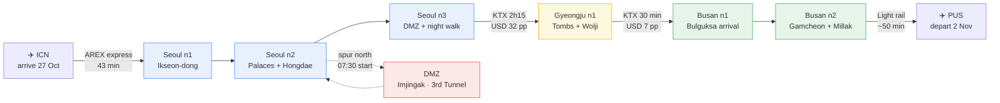

---
cssclasses:
  - korea-trip
---
# 🇰🇷 Korea 2026 — Start Here

**Seoul 3 nights → Gyeongju 1 night → Busan 2 nights. Arrive ICN 27 October → depart PUS 2 November 2026. 6 nights.** Proposed dates. The guide records no confirmed bookings.

**Day-by-day:** [[Korea 2026 — Itinerary|📖 Full seven-day itinerary]] · [[Korea 2026 — Daily Pocket Cards|📱 Compact plan for each date]]

**City and place guides:** [[Korea 2026 — Cafés and Shops|☕ Cafés, thrift, books and records]] · [[Korea 2026 — Food|🍽 Food and vegetarian options]] · [[Korea 2026 — Map View|🗺️ Interactive maps]] · [[Korea 2026 — Maps|📍 Every Maps search]]

**Practical:** [[Korea 2026 — Bookings|🎟️ Bookings]] · [[Korea 2026 — Budget|💰 Budget]] · [[Korea 2026 — Shopping shortlist|🛍 Shopping shortlist and ceiling]] · [[Korea 2026 — Transport|🚄 KTX, transit and DMZ]] · [[Korea 2026 — Weather and Packing|🧥 Weather and packing]] · [[Korea 2026 — Health preparation|🩺 Health and jet lag]] · [[Korea 2026 — Korean phrasebook|🗣️ The phrases that matter]] · [[Korea 2026 — Practical Info|🔌 Entry, money, drones and phone]]

**Creative:** [[Korea 2026 — My Five Things|💛 The five things this trip is for]] · [[Korea 2026 — Photography and Filming|📷 Shot ideas and film sequence]] · [[Korea 2026 — Autumn Foliage|🍂 Why late October, and where the colour is]]

## 📊 Progress

**Bookings**
```tracker
searchType: task
searchTarget: '.*'
file: Korea 2026 — Bookings.md
specifiedFilesOnly: true
bar:
```

**Packing**
```tracker
searchType: task
searchTarget: '.*'
file: Korea 2026 — Weather and Packing.md
specifiedFilesOnly: true
bar:
```

**Budget commitments**
```tracker
searchType: task
searchTarget: '.*'
file: Korea 2026 — Budget.md
specifiedFilesOnly: true
bar:
```

## 🗺️ The route



Seoul first because you land there, Busan last because Gimhae (PUS) removes the backtrack to ICN. Gyeongju sits on the line between them and its night is what makes Wolji Pond after dark possible without rushing.

## ⚠️ Three things to know before anything else

> [!warning] The DMZ is your one early morning
> Half-day tours depart **07:30–08:00**. Everything else in this plan starts at or after 08:30. This is the single unavoidable exception — six days of relaxed starts and one 07:30 coach.

> [!danger] Your passport is needed in hand on 29 October
> Physical passport, no copies, six months' validity. It is checked at military checkpoints before entering the DMZ. You need it again for tax refund shopping.

> [!warning] It is colder than the original dates suggested
> Seoul runs **12–16°C by day, 6–10°C at night**. Bring a real warm jacket, not a midweight. Wolji Pond and the Jeongdong night walk both happen after dark in gloves.

> [!danger] The palaces do not share a closing day
> **Gyeongbokgung closes Tuesdays. Changdeokgung, Deoksugung and Changgyeonggung close Mondays.** You land **Tuesday 27 October** — the one day Gyeongbokgung is shut. The plan visits on Wednesday, so it works, but anything that slides earlier hits a locked gate. Full table in [[Korea 2026 — Practical Info#🚪 Palace and site closure days|closure days]].

> [!warning] Halloween falls on your Saturday — but you will not be in Seoul for it
> **31 October is Halloween 2026**, the first Saturday-on-Halloween since 2022, and Seoul runs it as a managed public-safety event after the 2022 Itaewon crush that killed 159 people. **Your Seoul nights are the 27th–29th; the 30th and 31st are Gyeongju and Busan.** No collision — you are in the quietest place in the country when Seoul is busiest. Context, and one rule you should know regardless, in [[Korea 2026 — Practical Info#🎃 Halloween weekend, 27 Oct – 1 Nov|Halloween weekend]].

## ✅ Your next four actions

- [ ] **Book all six nights.** Seoul 3 (Euljiro or Ikseon-dong), Gyeongju 1 (**inside Hwangnidan-gil** so you can walk home from Wolji Pond), Busan 2 (Seomyeon).
- [ ] **Book the DMZ tour.** Passport details are needed at booking and autumn departures sell out.
- [ ] **Book both KTX legs** — Seoul→Gyeongju (30 Oct) and Gyeongju→Busan (31 Oct). Fares are fixed; booking early buys a seat, not a discount.
- [ ] **Book the PUS return on one ticket** — PUS→ICN→SCL or PUS→NRT/HND→SCL. Never self-transfer.

Record actual reservations in [[Korea 2026 — Bookings]]. A research idea becomes a commitment only once you book it.

## 🧭 Open decisions

| Decision | Current working assumption | What to record next |
| --- | --- | --- |
| Dates | 27 Oct – 2 Nov 2026 | Actual flight local times |
| Return route | Fly out of PUS | Compare PUS vs ICN total time and cost |
| Lodging tier | Hanok / guesthouse mix | Exact properties, taxes, cancellation cutoffs |
| City split | Seoul 3 · Gyeongju 1 · Busan 2 | Reconsider only if Gyeongju feels rushed |
| Seoul vintage | Hongdae / Yeonnam on 28 Oct | Traded the Secret Garden for this |
| DMZ | Half-day guided tour | Confirm or switch to the Unified Trail swap |
| Spending ceiling | US$2,500 working line | Personal ceiling and CLP conversion date |

## 💰 Budget you can use

Planned spending is **~US$2,395**, excluding international flights. This sits **US$105 under the US$2,500 working line** and **US$605 under US$3,000**. One traveler assumption is replaced by two here: lodging, rail, the DMZ tour and the shared transfer all scale to a pair.

| Line | Estimate | Note |
| --- | --- | --- |
| Lodging | US$721 | 6 nights, hanok/guesthouse mix |
| Food | US$750 | ~US$105/day for two |
| Cafés | US$120 | Three cities |
| Records, books, listening room, tea class | US$135 | Includes US$24 listening room |
| Intercity rail | US$79 | Fares are fixed by Korail |
| Local transit | US$95 | T-money, AREX, PUS light rail |
| DMZ tour | US$100 | US$42–60 pp |
| Entries | US$95 | Cable cars, Bulguksa, Seokguram, Wolji |
| Contingency | US$300 | Keep visible; do not pre-assign to shopping |

[[Korea 2026 — Budget|Open the budget note and enter actual amounts]]

## 📅 When to revisit

| Trigger | Action | Where to record it |
| --- | --- | --- |
| Each reservation | Save confirmation, record payment and the exact cancellation time zone | [[Korea 2026 — Bookings]] |
| **22 October** | 10-day weather forecast lands; choose the rain fallback | [[Korea 2026 — Itinerary]] |
| **27 October** | Re-check every small shop's hours on Naver Map | [[Korea 2026 — Cafés and Shops]] |
| Foliage reports | Ginkgo peaks nationally ~30 Oct; you will see it turning | [[Korea 2026 — Weather and Packing]] |
| 48 hours out | Reserve the Omma Temple vegetarian dinner in Gyeongju | [[Korea 2026 — Food]] |
| Each evening | Choose tomorrow's anchor, a nearby meal and a weather backup | Pocket card for tomorrow |

## 📱 Open the right note

| What you need | Note |
| --- | --- |
| The whole trip, day by day | [[Korea 2026 — Itinerary]] |
| Today's practical plan | [[Korea 2026 — Daily Pocket Cards]] |
| Reservations and deadlines | [[Korea 2026 — Bookings]] |
| Costs and the ceiling check | [[Korea 2026 — Budget]] |
| **What the trip is actually for** | [[Korea 2026 — My Five Things]] |
| **Shot ideas, light, film sequence** | [[Korea 2026 — Photography and Filming]] |
| **Why these dates, and where the colour is** | [[Korea 2026 — Autumn Foliage]] |
| Cafés, thrift, books, records | [[Korea 2026 — Cafés and Shops]] |
| What to eat, and without meat | [[Korea 2026 — Food]] |
| What to buy, and how much | [[Korea 2026 — Shopping shortlist]] |
| KTX fares, T-money, DMZ, airports | [[Korea 2026 — Transport]] |
| Cold, rain and what to pack | [[Korea 2026 — Weather and Packing]] |
| Vaccines, jet lag, kit, emergencies | [[Korea 2026 — Health preparation]] |
| **The Korean phrases that actually matter** | [[Korea 2026 — Korean phrasebook]] |
| Entry, money, drones, phone, closure days, Halloween | [[Korea 2026 — Practical Info]] |

## 🌸 Keep it flexible

Two or three anchors per day, each with a stop you can skip and a nearby meal. Day 2 and Day 6 are the densest; both have a named cut in the itinerary. Protect packing time before the two transfer days.

> [!info] Why late October
> Downtown Seoul foliage enters peak from ~24 October and ginkgo peaks nationally around 30 October. November 2026 has **no public holidays**, and your two substantive Seoul days (28 and 29 Oct) are weekdays — the quiet part of the busiest season. You will catch the trees turning rather than full gold. That is a forecast, not a promise.

> [!quote] A note on estimates
> Prices here are planning figures checked in October 2026, not quotes. Rail fares are regulated and reliable. Lodging, DMZ tours, café prices and admission charges are not. Treat every figure as something to confirm at the moment of booking.